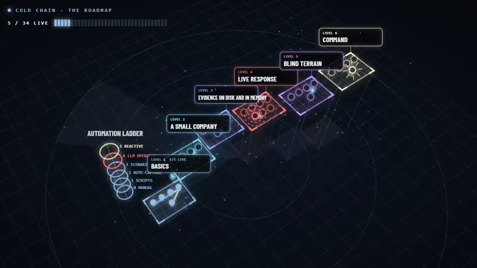

# COLD CHAIN

Hands-on incident response labs, starting from the basics. Every lab takes
place at the same made-up company: **Rimeport Cold Logistics**, which stores
and delivers chilled and frozen food.

**[Explore the interactive map →](https://cyberneticsintern.com/projects/lab-builds-and-writeups/coldchain-ir/)** Click any lab for its summary,
the writeup, the lab itself and my notes.

**Status:** Level 1 is complete: five labs, each tested on a real Windows 11
VM. Level 2 is planned next.

## Start here

👉 **[Level 1: Basics](labs/level-1/README.md)**

One Windows computer, one small thing to find, about an hour each.

## Read the writeups

Each lab also has a short writeup on my website, with what I found and what I
got wrong:
[COLD CHAIN on cyberneticsintern.com](https://cyberneticsintern.com/projects/lab-builds-and-writeups/coldchain-ir/)

## My notes

[`notes/`](notes/README.md) holds my own findings from each lab, kept separate
from the lab pages. They're one real run, not an answer key, and they contain
spoilers.

## Later

[`docs/DESIGN.md`](docs/DESIGN.md) holds the long-term ideas: unique
incidents per learner, a live range, more advanced levels. None of it is
needed for Level 1.

## License

Everything here (labs, explainers, notes and evidence files) is licensed under
[Creative Commons Attribution 4.0 International (CC BY 4.0)](LICENSE). You can
use, share and adapt it, including in your own training, as long as you give
credit, for example: *"COLD CHAIN by Shreyas Lipare,
github.com/UnderDogProfessor/coldchain-ir"*.
