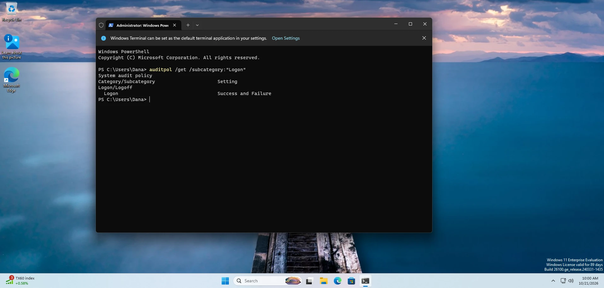
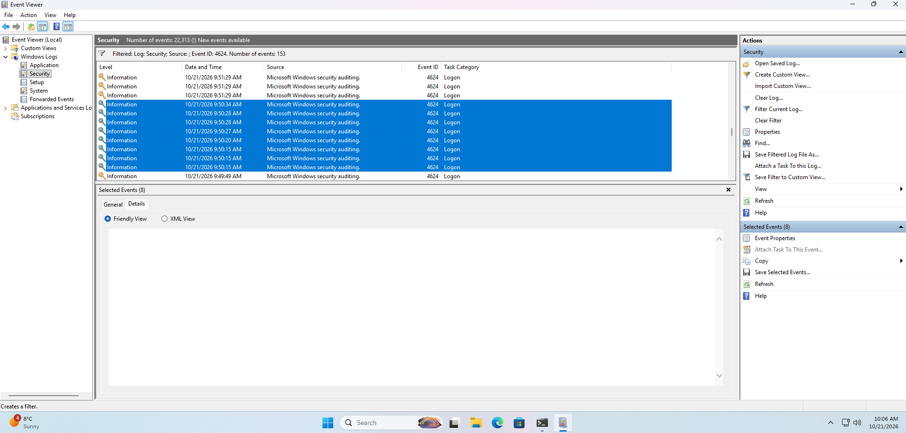

# My notes: Lab 1, What normal looks like

> ⚠️ Spoilers. Try [the lab](../../labs/level-1/01-what-normal-looks-like.md)
> first.

**Date done:** 2026-10-21
**Lab computer:** WS-DSP-01, Windows 11 Enterprise Evaluation (build 26100), VMware Workstation

## Attempts

**Attempt 1:** I completely forgot to note down timestamps for when I signed
in, when I locked my screen and when I restarted the computer. Without them I
had nothing to check the log against, so I'm doing it again.

**Attempt 2 (2026-10-21):** I'll start noting timestamps right after all the
Windows updates finish and the PC restarts. Updates done, snapshot taken and
named **WS-DSP-01 Clean**, then I started the PC. Before the snapshot I set the
VM's time zone to Eastern Time (US & Canada), so the VM's clock and my own
match.

---

## Part 1: What I did

| # | What I did | Time |
|---|---|---|
| 1 | Signed in as dana | 09:50 AM Eastern (my computer's clock) |
| 2 | Locked the screen with **Windows key + L**. Both my real computer and the VM locked. | 09:52 AM Eastern |
| 3a | Typed the wrong password by accident while unlocking | 09:54 AM Eastern |
| 3 | Unlocked it | 09:55 AM Eastern |
| 4 | Restarted (clicked Restart) | 09:57 AM Eastern |
| 5 | Signed in again after the restart | 09:58 AM Eastern |

## Part 2: Was Windows recording sign-ins?

What `auditpol` said on the **Logon** line: **Success and Failure** (checked
around 10:00 AM Eastern). I didn't change any settings, so this is the
default on a fresh install. Windows records both successful and failed
sign-ins here.

## Part 3: My answers

Filtering the Security log to event 4624 left **153** records. I see at least
**8** of them around my 09:50 sign-in (09:50:15 to 09:50:34).

### The 8 records from my 09:50 sign-in

| Time | Account Name | Logon Type | Elevated Token | Process |
|---|---|---|---|---|
| 09:50:15 | Dana | 2 | Yes | svchost.exe |
| 09:50:15 | Dana | 2 | No | svchost.exe |
| 09:50:15 | SYSTEM | 5 | Yes | services.exe |
| 09:50:20 | SYSTEM | 5 | Yes | services.exe |
| 09:50:27 | SYSTEM | 5 | Yes | services.exe |
| 09:50:28 | SYSTEM | 5 | Yes | services.exe |
| 09:50:28 | SYSTEM | 5 | Yes | services.exe |
| 09:50:34 | SYSTEM | 5 | Yes | services.exe |

The two Dana records point at each other. Logon ID `0xF2FC3` has Linked
Logon ID `0xF3008`, and `0xF3008` links back to `0xF2FC3`.

Just before my starting line, at **09:49:49**, there's one more record:
**SYSTEM, Logon Type 5, services.exe**. That's a background service from
Windows starting up, not me.

**1. My two sign-ins: logon type, and did the times match?**

First sign-in (09:50): two Dana records at 09:50:15, both Logon Type 2. That
matches my note.

Second sign-in (09:58): two Dana records at **09:58:44**, both Logon Type 2.
That matches my note. But there's *another* Dana pair before it, at 09:58:30
(see "After the restart" below).

**2. My unlock: logon type?**

Unlock (09:55): three records at **09:55:17**. Two are Dana, both **Logon Type
2**, not 7. They're another Elevated Token Yes/No pair, with Logon IDs
`0x4D2345` and `0x4D2374` linked to each other. The third is SYSTEM, Logon
Type 5. The Logon IDs are new, different from my 09:50 sign-in.

**Retest, a clean unlock.** The first try wasn't clean (Windows key + L locked
both computers, and I typed a wrong password first), so I did it again:

| What I did | Time |
|---|---|
| Locked from the Start menu, not Windows key + L | 10:24 (the clock turned 10:25 right after) |
| Unlocked with the right password, first try | 10:26 |

Result ([evidence](evidence/lab1-around-screenlock.evtx)): 13 sign-in records
from 10:25:57 to 10:26:21. The unlock is a Dana pair at **10:26:21**, both
**Logon Type 2** (Logon IDs `0xcfb871` and `0xcfb8c4`). The other 11 are
SYSTEM, Logon Type 5. **No Logon Type 7.** Nothing appears at the moment I
locked, because locking doesn't sign anyone in.

So on this computer, an unlock is Logon Type 2. Tested twice.

**3. A sign-in that wasn't me: which account?**

SYSTEM, Logon Type 5, started by services.exe, in every time window I looked
at. After the restart there were also UMFD-0, UMFD-1, DWM-1, LOCAL SERVICE and
NETWORK SERVICE (below).

**4. Roughly how many 4624 records after the restart, and why so many?**

**50 in 24 seconds** (09:58:28 to 09:58:52). Only 4 were Dana. The rest was
Windows starting up.

### After the restart (09:58)

Exported as [evidence/lab1-around-restart.evtx](evidence/lab1-around-restart.evtx).

| Time | Account | Logon Type | Notes |
|---|---|---|---|
| 09:58:28 | UMFD-0 (Font Driver Host) | 2 | Started by wininit.exe |
| 09:58:28 | UMFD-1 (Font Driver Host) | 2 | Started by winlogon.exe |
| 09:58:29 | DWM-1 (Window Manager), a pair | 2 | Started by winlogon.exe |
| 09:58:30 | **Dana, a pair** | 2 | Logon IDs `0x1c63c` / `0x1c6b4` |
| 09:58:44 | **Dana, a pair** | 2 | Logon IDs `0xc102a` / `0xc1076`. This is me. |
| 09:58:28 to 09:58:52 | SYSTEM ×40, LOCAL SERVICE ×1, NETWORK SERVICE ×1 | 5 | Started by services.exe |

What UMFD and DWM are, and why they matter:
[DWM and UMFD, explained](../../labs/explainers/dwm-and-umfd.md).

**Open question:** the 09:58:30 Dana pair came about one second after Windows
started, too fast for me to have typed my password. Windows may have signed me
in automatically after the restart and then locked the screen. Microsoft calls
this automatic restart sign-on (ARSO). If so, my 09:58 "sign-in" was really an
unlock, which would explain Logon Type 2 again. Not confirmed yet.

**Update, 2026-10-23.** I later read my full Security log from Lab 1 (22,314
events). It has the same pattern twice: a Dana pair of 4624 records at
**09:49:26**, about 49 seconds *before* my first sign-in at 09:50:15, and the
09:58:30 pair, 14 seconds before my sign-in at 09:58:44. Both come right after
Windows started, before I typed anything. Microsoft's documentation says
automatic restart sign-on is on by default and, on a computer that isn't joined
to a domain, applies to restarts I start myself as well as Windows Update
restarts ([source](https://learn.microsoft.com/en-us/windows-server/identity/ad-ds/manage/component-updates/winlogon-automatic-restart-sign-on--arso-)).
That fits, but I still haven't seen LSA event 320, which would confirm it, so
it stays unconfirmed. I missed the 09:49:26 pair at first because I only looked
at the records near my own times.

**5. Normal on WS-DSP-01, in three sentences:**

1. When Dana signs in, the log shows two Logon Type 2 records and one Logon
   Type 5 in the same second. That's expected for this account: Dana is an
   administrator, so her sign-in gets both an admin key and an everyday key,
   which makes two Logon Type 2 records.
2. When she unlocks her screen, it shows as Logon Type 2, the same as a
   sign-in.
3. Most sign-in records on this computer are SYSTEM.

---

## What surprised me

When I first signed in and looked at the event log, I found three records with
the same timestamp: two Logon Type 2 and one Logon Type 5. It was a little
confusing, but with a little research it became clear.

## What didn't match the lab page

Anything here gets fixed in the lab.

- The lab said DWM- and UMFD- accounts start whenever someone signs in. None
  of my eight 09:50 records were DWM or UMFD, only Dana and SYSTEM. The
  09:49:49 record from startup was SYSTEM too. **Fixed:** removed DWM and UMFD
  from the lab on 2026-10-21, to add back later only if I find them.
- The lab said an unlock is usually Logon Type 7. Mine was **Logon Type 2**: a
  fresh pair of Dana records that looks just like a sign-in. Only my notes told
  me it was the unlock. But I locked with Windows key + L (both computers
  locked) and typed a wrong password first, so this wasn't a clean test.
  **Retested cleanly at 10:26: Logon Type 2 again.** The lab's answer stands.
- DWM and UMFD *do* show up, but at startup (09:58:28 to 09:58:29 after my
  restart), not at my own sign-ins. **Fixed:** added back to the lab on
  2026-10-21, described as appearing at startup.

## Evidence files

Exported from Event Viewer with **Save Filtered Log File As**. Anyone can open
them in Event Viewer (**Action → Open Saved Log**).

- [lab1-around-restart.evtx](evidence/lab1-around-restart.evtx): 50 sign-in
  records, 09:58:28 to 09:58:52
- [lab1-around-screenlock.evtx](evidence/lab1-around-screenlock.evtx): 13
  sign-in records, 10:25:57 to 10:26:21

## Screenshots

Lab 1 was written before screenshots were numbered, so its files keep
descriptive names.

| File | Lab part | What it shows |
|---|---|---|
| `lab1-auditpol.webp` | Part 2 | `auditpol` showing Logon: Success and Failure |
| `lab1-filtered-list.png` | Part 3, the filter | The Security log filtered to 4624 (153 records) |
| `lab1-q1-signin.png` | Question 1 | **Not taken** |
| `lab1-q2-unlock.png` | Question 2 | **Not taken** |
| `lab1-q3-not-me.png` | Question 3 | **Not taken** |

For questions 1 to 3 I copied the records as text and exported them as `.evtx`
files (see Evidence files above) instead of taking screenshots.
