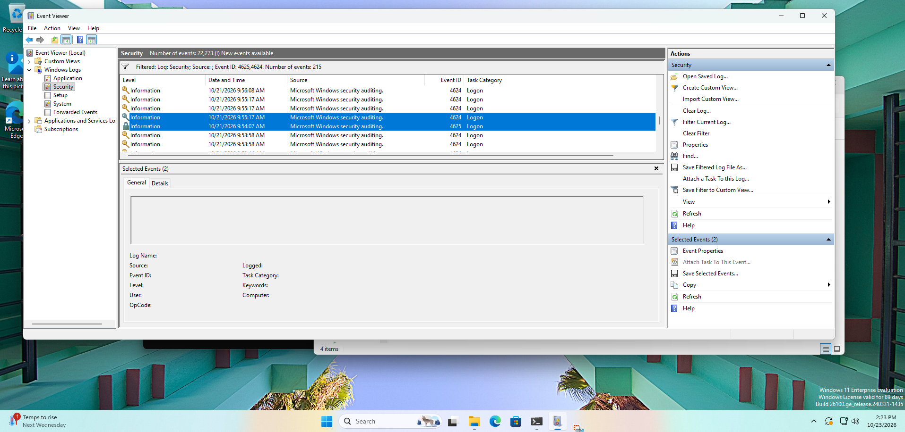
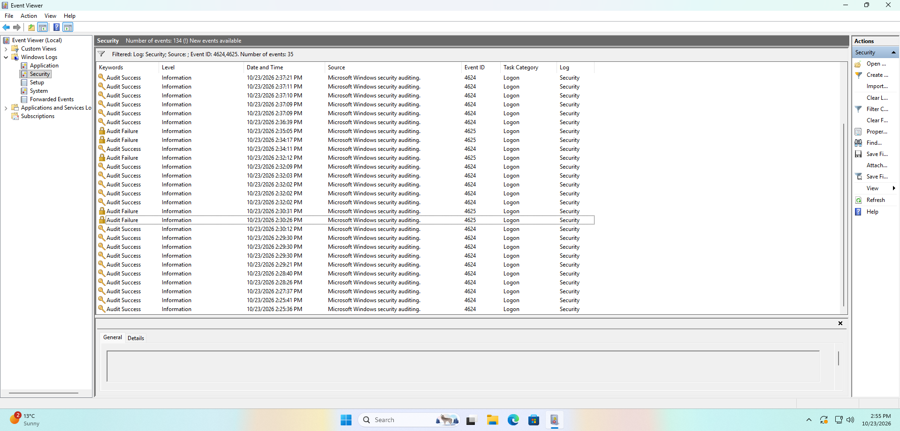
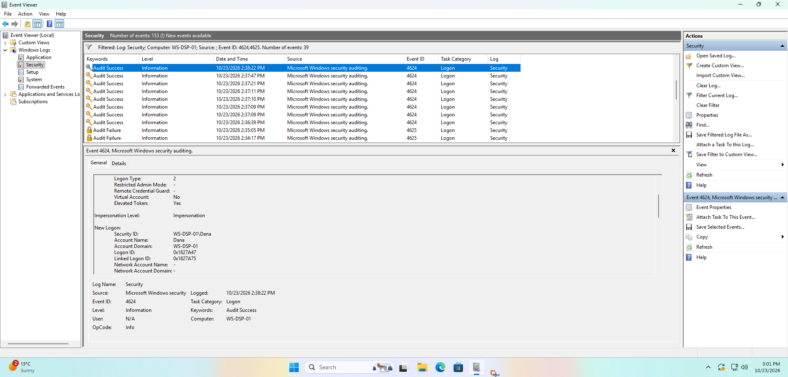

# My notes: Lab 2, Someone is guessing passwords

> ⚠️ Spoilers. Try [the lab](../../labs/level-1/02-someone-is-guessing-passwords.md)
> first.

**Date done:** 2026-10-23
**Lab computer:** WS-DSP-01, Windows 11 Enterprise Evaluation (build 26100), VMware Workstation

---

## Part 1: The evidence I already had

My accidental wrong password from Lab 1 was at **09:54 AM Eastern** on
2026-10-21.

| What I looked for | What I found |
|---|---|
| 4625 record at 09:54? | Yes, at 09:54:07 AM (event 4625) |
| Account Name (Account For Which Logon Failed) | Dana |
| Logon Type | 2 |
| Failure Reason | Unknown user name or bad password. |
| Sub Status | 0xC000006A |
| Next successful sign-in for Dana after it | 10/21/2026 9:55:17 AM |

## Part 2: What I did as the guesser

Done on 2026-10-23. Times are Eastern.

| # | What I did | Time |
|---|---|---|
| 1 | Signed in as Dana | 02:29 PM |
| 2 | Locked the screen from the Start menu | 02:30 PM |
| 3 | Typed 5 wrong passwords | 1st: 2:30 PM, 2nd: 2:30 PM, 3rd: 2:32 PM, 4th: 2:34 PM, 5th: 2:35 PM |
| 4 | Waited 2 minutes | |
| 5 | Unlocked as Dana with the right password | 02:38 PM |

## Part 3: My answers

**1. How many failed sign-ins, and how long from first to last?**

5 wrong passwords, at 2:30 PM, 2:30 PM, 2:32 PM, 2:34 PM and 2:35 PM.

Exact times from my screenshot: **2:30:26, 2:30:31, 2:32:12, 2:34:17 and
2:35:05 PM**. That's 4 minutes 39 seconds from the first to the last.

**2. Which account, and what does the Sub Status say?**

All the failed logins were for the account Dana, with Sub Status 0xC000006A.

I also saw several successful logins during the time I was entering the 5
wrong passwords. All of them were Logon Type 5 and the account SYSTEM. So even
though I didn't sign in, I see these SYSTEM successful logins with Logon Type 5.

**3. Where did the guesses come from?**

(Read three fields in a 4625 record, exactly as they appear: **Logon Type** =
how they tried, 2 means at the keyboard; **Workstation Name** = which
computer; **Source Network Address** = which address, `127.0.0.1` means this
computer itself. Then answer in one sentence: at this computer's keyboard, or
somewhere else on the network. The process name isn't needed.)

- Workstation Name: WS-DSP-01
- Source Network Address: 127.0.0.1
- Logon Type: *(not written down for the 5 guesses; the Part 1 typo was 2)*
- One-sentence answer: *(still to add)*

**4. My rule of thumb for a typo vs. guessing:**

Typo rather keyboard hits. *(To rewrite in my own words. The data to compare
is below.)*

| | Failures | Time from first to last failure | Next success |
|---|---|---|---|
| Lab 1 typo | 1 | not applicable | 1 min 10 s later (09:54:07 → 09:55:17) |
| Part 2 guesses | 5 | 4 min 39 s | 3 min 17 s later (2:35:05 → 2:38:22) |

**5. Dana's next successful sign-in, and can the log prove it was her?**

Yes. It came after my last failed login at 2:35 PM. I see 7 successful logins
(event 4624, which I first wrote as 4654) for SYSTEM with Logon Type 5 before
it. Then at **2:38:22 PM**, exactly my time, I see Logon Type 2 for Account
Name Dana, which proves my successful sign-in.

Details of that record (screenshot below): Logon Type 2, Elevated Token Yes,
Account Name Dana, Logon ID `0x1827A47`, Linked Logon ID `0x1827A75`.

---

## What surprised me

In Lab 2 I saw so many successful login records that I didn't do myself. All
of them were from the account SYSTEM with Logon Type 5.

## What didn't match the lab page

Anything here gets fixed in the lab.

- The lab said the five guesses would take "about a minute". Mine took 4
  minutes 39 seconds, because I typed slowly while checking the screen. The
  lab's wording is being changed.
- The unlock at 2:38:22 PM was Logon Type 2 again, the third time I've seen an
  unlock logged as type 2 on this computer, not type 7.

## Evidence files

None exported this time. I took screenshots only.

## Screenshots

- `lab2-old-typo.png`: the Lab 1 typo (4625 at 09:54:07 AM) and the sign-in at
  09:55:17 AM
- `lab2-guesses.png`: the five failures between 2:30:26 PM and 2:35:05 PM
- `lab2-unlock.png`: Dana's sign-in record at 2:38:22 PM
