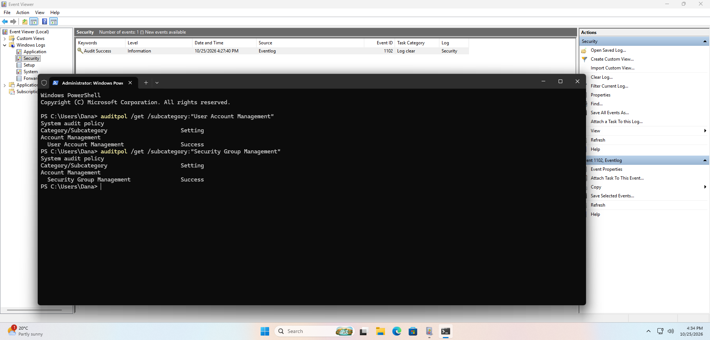
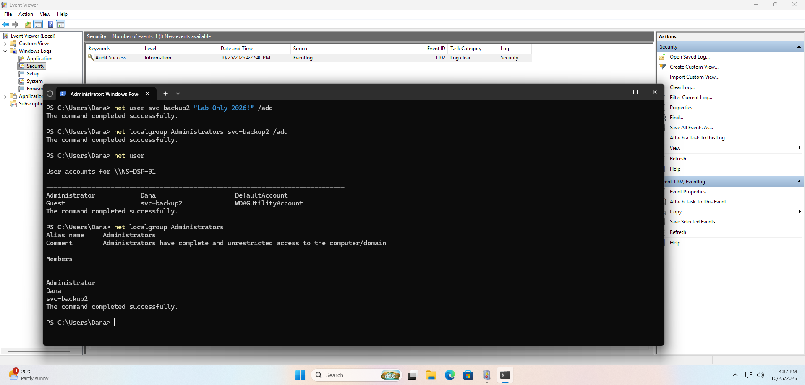
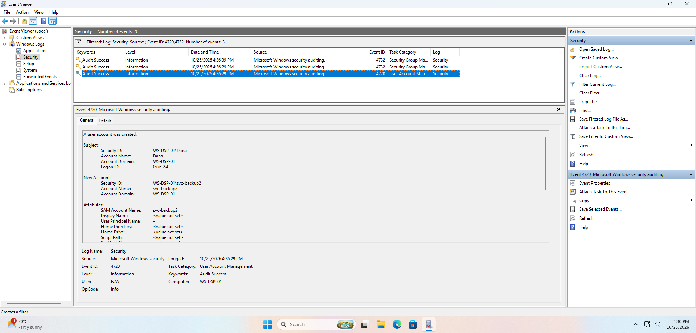
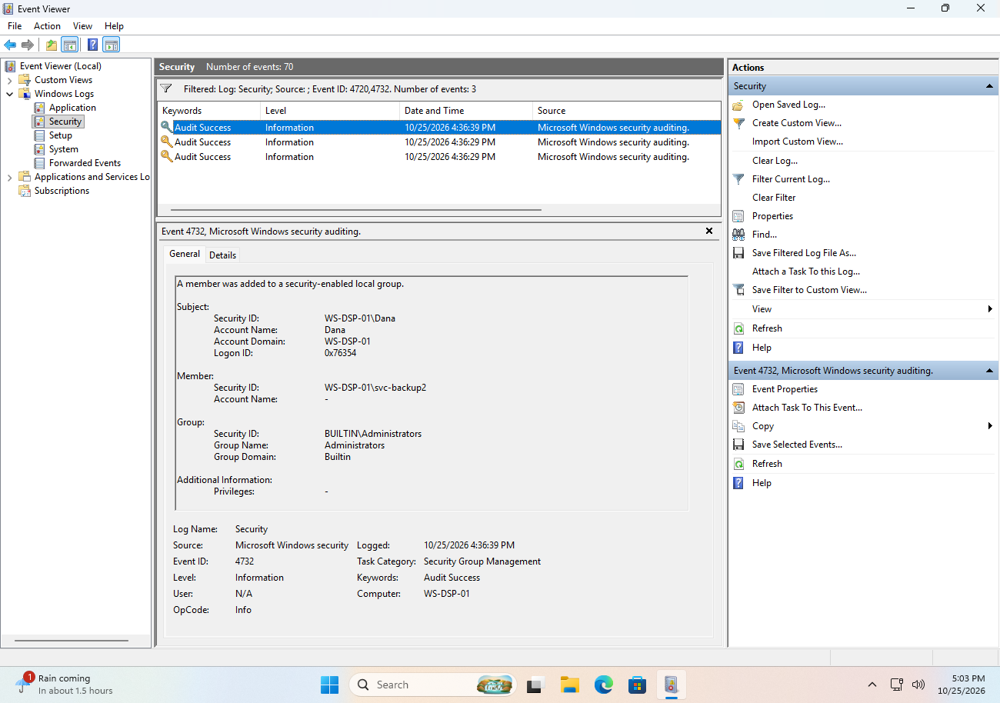
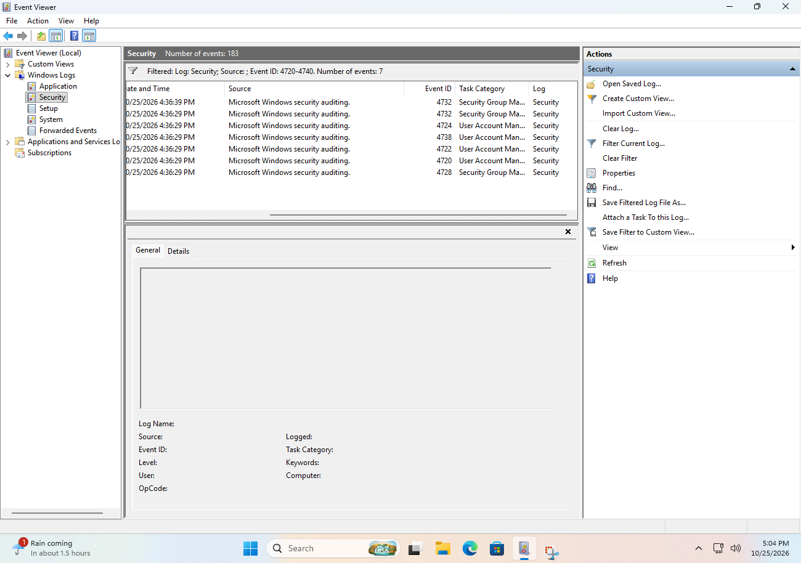
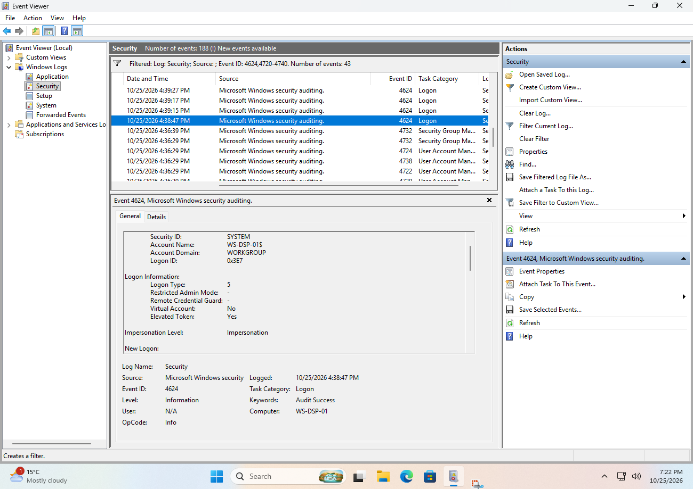
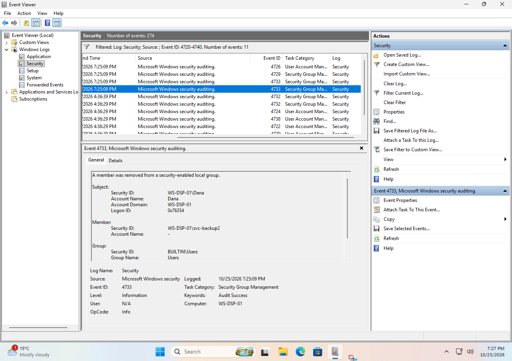
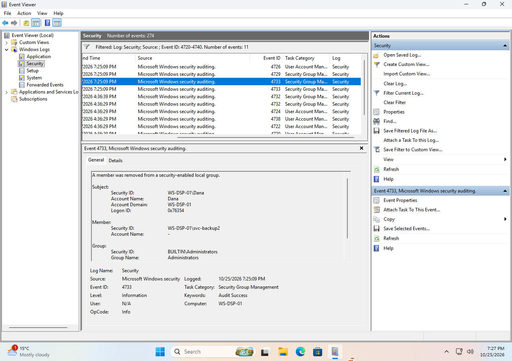
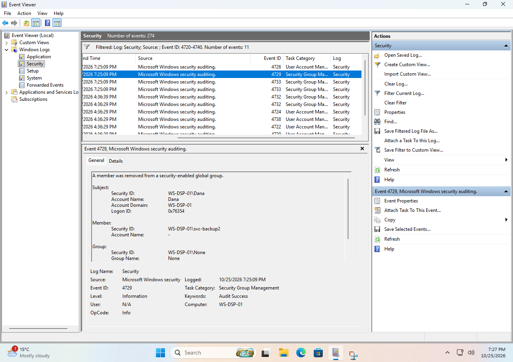
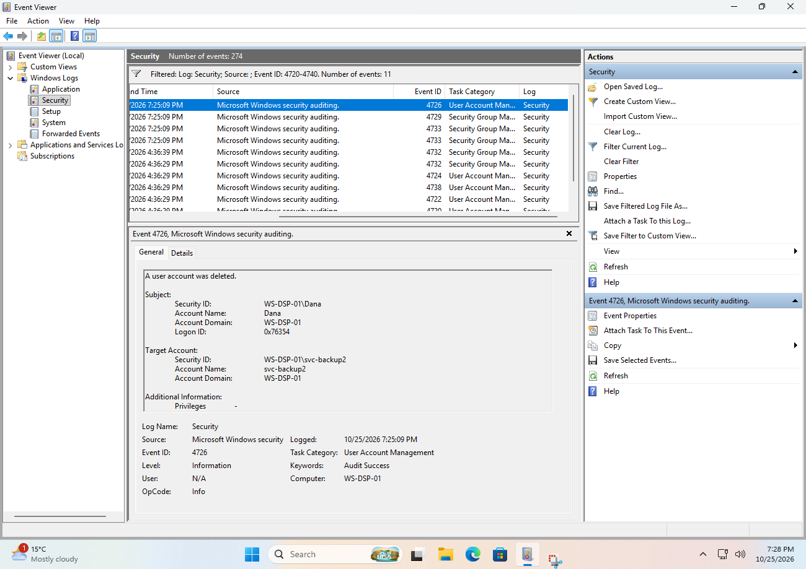

# My notes: Lab 3, A new account appeared

> ⚠️ Spoilers. Try [the lab](../../labs/level-1/03-a-new-account-appeared.md)
> first.

**Date done:** 2026-10-25
**Lab computer:** WS-DSP-01, Windows 11 Enterprise Evaluation (build 26100), VMware Workstation

Screenshots are numbered in the order the lab asks for them. Each one sits
under the part where the lab first asks for it. Times are Eastern.

Before this lab I cleared the Security log to get a clean view. The log
records that: event **1102**, "the audit log was cleared," at **4:27:40 PM**
(you can see it in Screenshots 1 and 2). That choice affected what I could
find, as you'll see below.

---

## Part 1: Is Windows recording account changes?

| Setting | What auditpol said |
|---|---|
| User Account Management | Success |
| Security Group Management | Success |

📸 Screenshot 1 (`lab3-1.png`): both auditpol results

## Part 2: What I did as the intruder

I wrote one time range for all three steps ("04:36 PM to 04:37 PM"). The log
gives the exact times:

| # | What I did | My note | Time in the log |
|---|---|---|---|
| 1 | Created svc-backup2 | 4:36 to 4:37 PM | 4:36:29 PM (event 4720) |
| 2 | Added it to Administrators | 4:36 to 4:37 PM | 4:36:39 PM (event 4732, Administrators) |
| 3 | Checked with `net user` and `net localgroup Administrators` | 4:36 to 4:37 PM | about 4:37 PM (the clock in Screenshot 2) |

📸 Screenshot 2 (`lab3-2.png`): svc-backup2 in the Administrators list

## Part 3: What I found

| Record | Time | Subject (who did it) | Subject Logon ID | Object (who it was done to) |
|---|---|---|---|---|
| 4720, account created | 4:36:29 PM | Dana (WS-DSP-01) | `0x76354` | svc-backup2, SID ending `-1002` |
| 4732, added to a group (Administrators) | 4:36:39 PM | Dana (WS-DSP-01) | `0x76354` | Member SID ending `-1002`, group Administrators (Builtin) |

📸 Screenshot 3 (`lab3-3.png`): the 4720 record

📸 Screenshot 4 (`lab3-4.png`): the 4732 record

**Do the two Security IDs match?** Yes. The New Account in the 4720 and the
Member in the 4732 are the same SID (`S-1-5-21-…-1002`), so both records are
about the same account. In the 4732 the Member's Account Name is just `-`, as
Microsoft's documentation says it usually is for local groups, so the SID is
what names the account.

**Other event IDs I saw next to them** (the filter `4720-4740` gave 7 records,
all from the same second except my admin add):

| Time | ID | What it is | Detail from my log |
|---|---|---|---|
| 4:36:29 PM | 4728 | A member was added to a security-enabled global group | The new account joined the group `None` |
| 4:36:29 PM | 4720 | A user account was created | |
| 4:36:29 PM | 4722 | A user account was enabled | |
| 4:36:29 PM | 4738 | A user account was changed | |
| 4:36:29 PM | 4724 | An attempt was made to reset an account's password | The password I set in the command |
| 4:36:29 PM | 4732 | A member was added to a local group | Group **Users** (added automatically) |
| 4:36:39 PM | 4732 | A member was added to a local group | Group **Administrators** (my step 2) |

All of them name Dana as the Subject, with Logon ID `0x76354`.

📸 Screenshot 5 (`lab3-5.png`): the neighboring records

**Matching sign-in (4624) for the Logon ID, Elevated Token Yes or No?** I
couldn't find one. No 4624 in either of my exports has the Logon ID `0x76354`.
The sign-in that created it happened **before** I cleared the log at 4:27:40
PM, so the record was erased. Screenshot 6 shows a SYSTEM, Logon Type 5 record
at 4:38:47 PM, which is not the match.

📸 Screenshot 6 (`lab3-6.png`): a 4624 record from the list. It is **not** the
sign-in behind the account, because that record no longer exists.

## Part 4: After cleanup

I deleted the account at **7:25 PM** (the log says 7:25:09 PM). The creation
records are all still in the log, and the delete wrote **four** new records:

| Time | ID | What it is |
|---|---|---|
| 7:25:09 PM | 4733 | Removed from the local group **Users** |
| 7:25:09 PM | 4733 | Removed from the local group **Administrators** |
| 7:25:09 PM | 4729 | Removed from the global group **None** |
| 7:25:09 PM | 4726 | The user account was deleted |

All four name Dana as the Subject with the same Logon ID, **`0x76354`**, as
the creation, 2 hours 48 minutes 39 seconds earlier. That means the same sign-in
session created the account and deleted it.

📸 Screenshots 7.1 to 7.4: one for each of the four new records.

## Questions

*Answers drafted by Claude from my notes and my two exported logs, at my
request.*

**1. Account name and creation time?**

svc-backup2, created at **4:36:29 PM** on 2026-10-25 (event 4720). I noted it
as "4:36 PM".

**2. Who created it, and what can't the record prove?**

The Subject of the 4720 is the account **Dana** on WS-DSP-01, in the sign-in
session with Logon ID `0x76354`. It can't prove who was typing. It shows which
account's session did it, not which person. (In this lab it was me, signed in
as Dana.)

**3. Admin rights: which record, and how do I know it's the same account?**

Event **4732** at 4:36:39 PM added the member to the **Administrators** group
(Builtin). The Member's Security ID matches the New Account's Security ID in
the 4720. There's a second 4732 at 4:36:29 PM for the group **Users**. That one
happened automatically, and only the Administrators one was my step.

**4. Which sign-in did it?**

Logon ID **`0x76354`**, from the Subject of the 4720. I can't say whether it
was the Elevated Token Yes or No record of Dana's pair, because that 4624 isn't
in my exports: I cleared the log after the sign-in. What I can show is that the
same Logon ID appears in all four delete records 2 hours 48 minutes later, so
the same session did both. The later Dana pairs in my export (`0xedadb2` and
`0xedade1` at 5:02:16 PM, `0x16efe05` and `0x16efe72` at 7:19:48 PM) are
different sessions.

**5. After the delete, what's still in the log? Two sentences for my team lead:**

The creation, the password set and both group additions are still there, and
the delete added four more records. Dana's account (session `0x76354`) created
svc-backup2 at 4:36:29 PM and added it to Administrators at 4:36:39 PM, and the
same session deleted it at 7:25:09 PM. I can't tell who was typing, and the
sign-in that started the session is missing because I cleared the log first.

---

## What surprised me

*(To add.)*

## What I missed, and noticed later

After finishing, I compared my notes against my exported logs. Here's what I
missed.

1. **I wrote one time range for three steps.** I noted "4:36 to 4:37 PM" for
   each step. The log shows the creation at 4:36:29 and the admin add at
   4:36:39, ten seconds apart. Write the time of each step as you do it.
2. **I cleared the log first, and that erased the sign-in this lab traces.**
   I wanted a clean view, but the 4624 for the session that created the account
   was in what I deleted, so I couldn't answer "which sign-in did it?" from the
   log. If you want a clean view, use **Save and Clear** and keep the saved
   file, or don't clear at all.
3. **I didn't expect two 4732 records.** Filtering `4720,4732` gave three
   records, not two. One 4732 (Users, 4:36:29 PM) is added automatically. Mine
   (Administrators, 4:36:39 PM) is the one that matters. Check the Group Name.
4. **I didn't notice the account joined two groups by itself.** It was added to
   the local group Users and the global group None the moment it was created
   (4732 and 4728).
5. **My Screenshot 6 shows the wrong kind of record, and I didn't say so.** It
   shows a SYSTEM sign-in because the matching one didn't exist. I should have
   written that down next to it.
6. **I didn't write my own answers.** My notes had the questions and the times,
   but not the answers. A reader can't tell what I concluded. Write each answer
   in your own words right after you find it.
7. **I didn't notice the delete reused the creation's Logon ID.** All four
   delete records carry `0x76354`, the same as the creation. That's a strong
   link: the same session created and deleted the account.
8. **The delete wrote four records, not one.** Deleting the account also
   removed it from Users, Administrators and the global group None (4733, 4733
   and 4729) before the 4726. I captured all four with screenshots, which was
   the right instinct.

**Tip for next time:** before changing anything on the computer, ask what the
next step will erase, and export it first.

## What didn't match the lab page

Anything here gets fixed in the lab.

- The lab said "find the 4732 record from step 2." There are two 4732 records,
  one for Users and one for Administrators.
- The lab expected the matching 4624 to be findable. It's gone if the log was
  cleared first.
- The lab expected the delete to leave one new record. It leaves four.

## Evidence files

- [lab3-new-account.evtx](evidence/lab3-new-account.evtx): 60 records from
  4:28:27 PM to 7:22:42 PM on 2026-10-25, filtered to 4624 and 4720-4740. It has
  the creation records (4728, 4720, 4722, 4738, 4724 and two 4732) and the
  sign-ins around them.
- [lab3-delete-account.evtx](evidence/lab3-delete-account.evtx): the four
  records from the delete at 7:25:09 PM (4733, 4733, 4729 and 4726).

Neither file contains the 1102 at 4:27:40 PM, because I filtered it out, but
Screenshots 1 and 2 show it.

## Screenshots

| # | File | Lab part | What it shows |
|---|---|---|---|
| 1 | `lab3-1.png` | Part 1 | auditpol results, with the 1102 log clear behind |
| 2 | `lab3-2.png` | Part 2 | svc-backup2 in Administrators |
| 3 | `lab3-3.png` | Part 3 | 4720, account created |
| 4 | `lab3-4.png` | Part 3 | 4732, added to Administrators |
| 5 | `lab3-5.png` | Part 3, neighbors | the seven records from 4720 to 4740 |
| 6 | `lab3-6.png` | Part 3, matching sign-in | a SYSTEM 4624 (not the match; the match is missing) |
| 7.1 | `lab3-7.1.png` | Part 4 | 4733, removed from Users |
| 7.2 | `lab3-7.2.png` | Part 4 | 4733, removed from Administrators |
| 7.3 | `lab3-7.3.png` | Part 4 | 4729, removed from the global group None |
| 7.4 | `lab3-7.4.png` | Part 4 | 4726, user account deleted |
