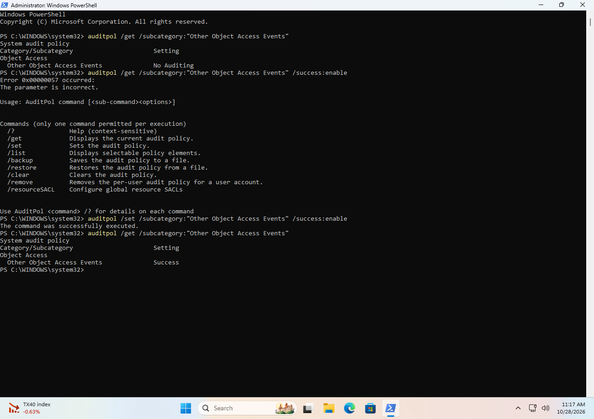
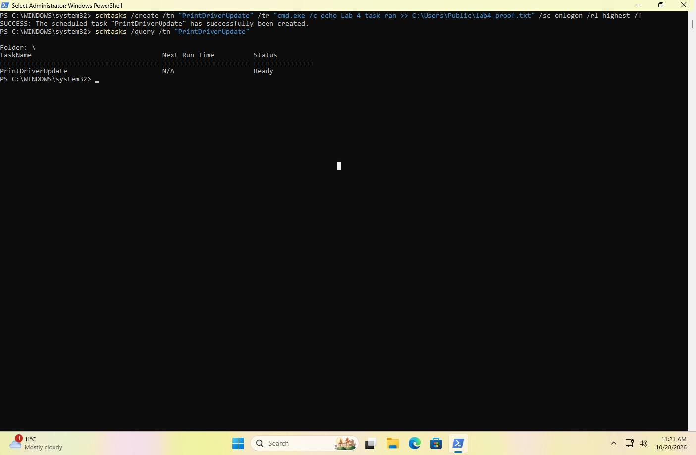
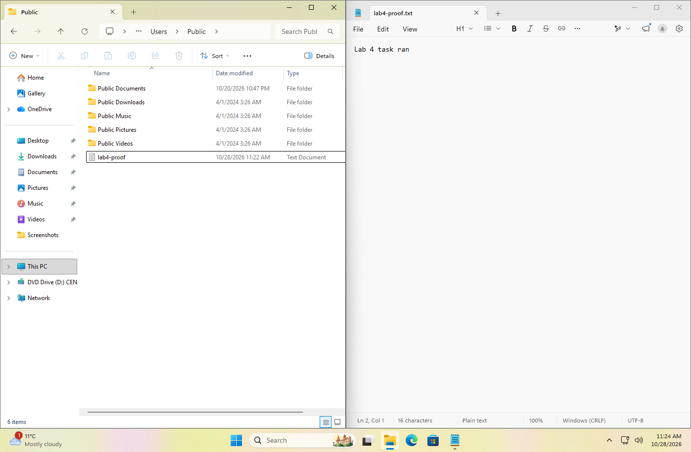
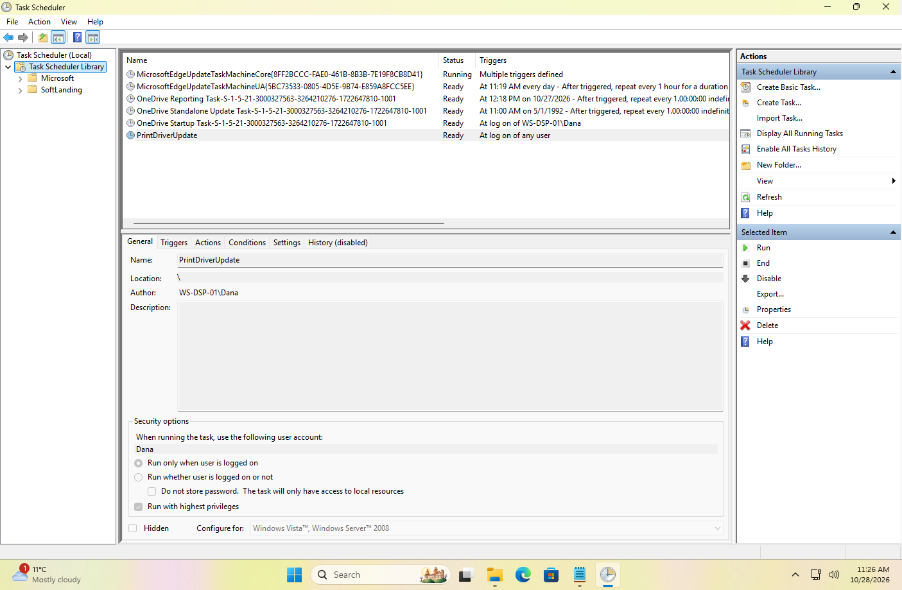
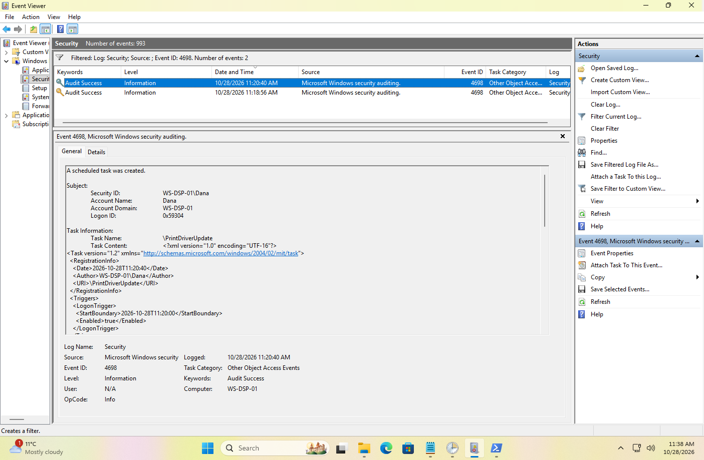
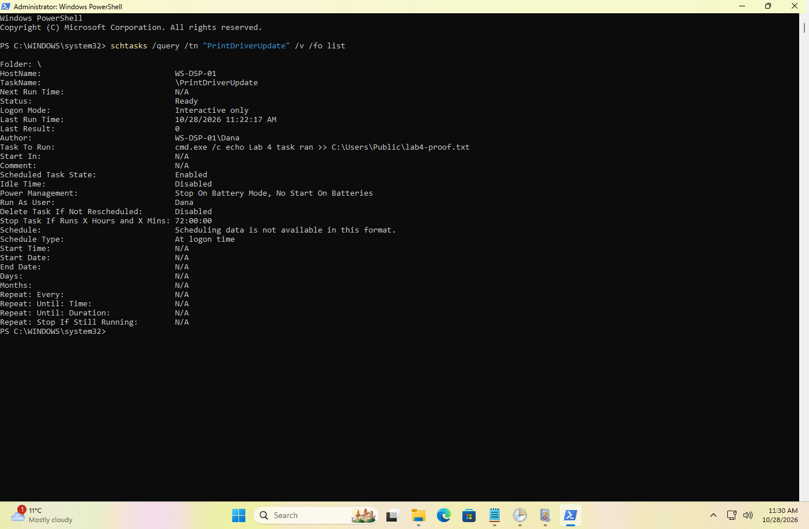
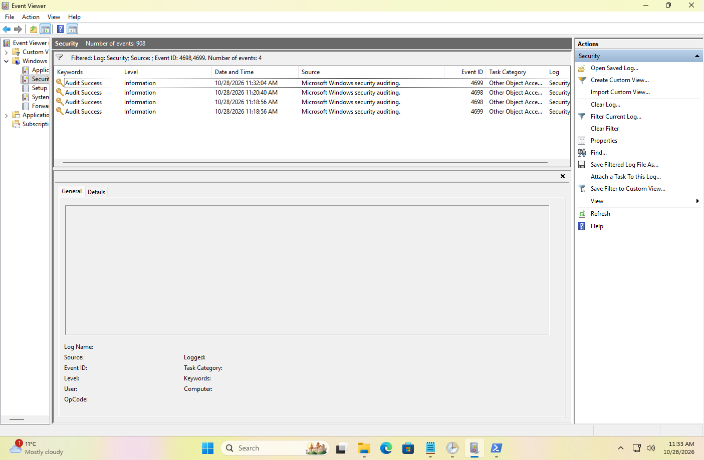

# My notes: Lab 4, Something runs at startup

> ⚠️ Spoilers. Try [the lab](../../labs/level-1/04-something-runs-at-startup.md)
> first.

**Date done:** 2026-10-28
**Lab computer:** WS-DSP-01, Windows 11 Enterprise Evaluation (build 26100), VMware Workstation

> **At a glance**
>
> - **The goal:** find what was set up to run at every sign-in: what, who and
>   when.
> - **The audit setting was off.** "Other Object Access Events" said No
>   Auditing until I turned it on at 11:17 AM.
> - **Created 11:20:40 AM by Dana's admin session.** Its Logon ID `0x59304`
>   matches the Elevated Token **Yes** half of her 11:12:36 sign-in. In Lab 3 I
>   couldn't make that match. This time I could.
> - **It ran 3 seconds after I signed in** after the restart: sign-in 11:22:14,
>   Last Run Time 11:22:17.
> - **I wasn't the only one making tasks.** OneDrive deleted and re-created its
>   own task "as Dana" two minutes before mine.
> - **The deletion record kept the name but not the contents.** The 4699 had an
>   empty Task Content.

Screenshots are numbered in the order the lab asks for them. Each one sits
under the part where the lab first asks for it. Times are Eastern.

I didn't write times down as I went this time. Every time below comes from the
log or from the clock in a screenshot.

I started from a snapshot I took just before the lab, "Before Lab 4" (11:06
AM), and didn't clear the Security log.

---

## Part 1: Was Windows recording scheduled tasks?

| When | What auditpol said |
|---|---|
| Before | **No Auditing** |
| After `auditpol /set ... /success:enable` | **Success** |

My first try typed `/get` with `/success:enable`, which gave "Error
0x00000057, The parameter is incorrect." The second try used `/set` and
worked. Both are in the screenshot.

📸 Screenshot 1 (`lab4-1.png`): before and after, 11:17 AM

## Part 2: What I did as the intruder

| # | What I did | Time | Where the time comes from |
|---|---|---|---|
| 1 | Created PrintDriverUpdate with `schtasks /create` | 11:20:40 AM | 4698 |
| 2 | Checked it with `schtasks /query`: Status Ready, Next Run Time N/A | 11:21 AM | Screenshot 2.1 clock |
| 3 | Restarted | between 11:21 and 11:22 | the gap in the log |
| 4 | Signed in as Dana | 11:22:14 AM | 4624, Logon IDs `0x1d23d` and `0x1d2bf` |
| 5 | Found `lab4-proof.txt` in `C:\Users\Public` | file stamped 11:22 AM | Screenshot 2.2 |

📸 Screenshot 2.1 (`lab4-2.1.png`): creating the task and checking it

📸 Screenshot 2.2 (`lab4-2.2.png`): the proof file, one line

## Part 3: What I found

### In Task Scheduler

| What | What it showed |
|---|---|
| Location | `\`, the top folder of the Task Scheduler Library |
| Author | `WS-DSP-01\Dana` |
| Trigger | At log on of any user |
| Runs as | Dana, "Run only when user is logged on", **Run with highest privileges** ticked |
| History tab | **History (disabled)**, and the right pane offered **Enable All Tasks History** |

The top folder wasn't empty apart from mine. Two Microsoft Edge update tasks
and three OneDrive tasks sit there too. So being in the top folder made it
worth a look, but it didn't make it suspicious by itself.

Task history was off, so Task Scheduler wasn't keeping its own record of runs
on this computer.

📸 Screenshot 3 (`lab4-3.png`): the task's General tab

### The creation record: 4698

| Field | Value |
|---|---|
| Time | 11:20:40 AM |
| Subject | Dana (WS-DSP-01), Logon ID **`0x59304`** |
| Task Name | `\PrintDriverUpdate` |

Inside **Task Content**:

| Part | Value |
|---|---|
| `<Author>` | `WS-DSP-01\Dana` |
| `<Date>` | 2026-10-28T11:20:40 |
| `<LogonTrigger>` | StartBoundary 2026-10-28T11:20:00 |
| `<RunLevel>` | `HighestAvailable` |
| `<UserId>` | `WS-DSP-01\Dana` |
| `<Command>` | `cmd.exe` |
| `<Arguments>` | `/c echo Lab 4 task ran >> C:\Users\Public\lab4-proof.txt` |

📸 Screenshot 4 (`lab4-4.png`): the 4698 for PrintDriverUpdate

**There were two 4698 records, not one.** At 11:18:56 AM, OneDrive deleted
and re-created its own task, `\OneDrive Standalone Update Task-S-1-5-21-…-1001`.
Its Author is `Microsoft Corporation`, it runs
`OneDriveStandaloneUpdater.exe` on a timer, and its Subject is **Dana**, with
Logon ID `0x59463`. Nobody typed anything for that one.

**Which sign-in created my task?** Dana signed in at **11:12:36 AM** and the log
wrote the usual pair:

| Logon ID | Elevated Token | Used by |
|---|---|---|
| `0x59304` | **Yes** | my task (Terminal (Admin)) |
| `0x59463` | No | OneDrive's task |

### Did it actually run?

`schtasks /query /tn "PrintDriverUpdate" /v /fo list` said:

| Field | Value |
|---|---|
| Last Run Time | **10/28/2026 11:22:17 AM** |
| Last Result | 0 |
| Logon Mode | Interactive only |
| Schedule Type | At logon time |
| Task To Run | `cmd.exe /c echo Lab 4 task ran >> C:\Users\Public\lab4-proof.txt` |

That's 3 seconds after my 11:22:14 sign-in, and the proof file was stamped 11:22
with one line in it. Two separate pieces of evidence agree.

📸 Screenshot 5 (`lab4-5.png`): the verbose query

**Background noise:** my export also has **36** event 4702 records ("a
scheduled task was updated") between 11:16 and 11:27. Almost all are Windows
updating its own tasks, such as UpdateOrchestrator, with the computer account
`WS-DSP-01$` as the Subject. The other two are OneDrive's.

### Export

I saved `4624,4698-4702` as `lab4-startup-task.evtx` at 11:31 AM, before
cleaning up.

## Part 4: After cleanup

I deleted the task at **11:32:04 AM** (event 4699). The 4698 from 11:20:40 is
still in the log afterward.

| Field | Value |
|---|---|
| Subject | Dana, Logon ID `0x1d23d`, the Elevated Token Yes half of my 11:22:14 sign-in |
| Task Name | `\PrintDriverUpdate` |
| Task Content | **empty** |

The lab expected the 4699 to keep a full copy of the task. On this computer it
didn't. Only the 4698 says what the task did.

📸 Screenshot 6 (`lab4-6.png`): the 4698 and 4699 records together

## Questions

**1. What was set up, what's it called, and where is it?**

A scheduled task called **PrintDriverUpdate**, in the top folder of the Task
Scheduler Library (`\`), set to run at the log on of any user. The top folder
alone didn't give it away, because Edge and OneDrive keep tasks there too. What
gave it away was what it runs.

**2. When was it created, and by which account? What can't the record prove?**

At **11:20:40 AM**, by Dana's account. The 4698 Subject and the `<Author>` both
say so. Its Logon ID `0x59304` is the Elevated Token Yes half of the 11:12:36
sign-in, which fits a command run from Terminal (Admin). It can't prove a person
did it. OneDrive created a task as Dana two minutes earlier with nobody typing.

**3. What does it run, when, and with what rights?**

`cmd.exe` with `/c echo Lab 4 task ran >> C:\Users\Public\lab4-proof.txt`
(`<Command>` and `<Arguments>`), at every sign-in (`<LogonTrigger>`), with the
highest rights Dana's account has (`<RunLevel>HighestAvailable`).

**4. Did it actually run? Two pieces of evidence.**

Yes. `schtasks /query /v` shows a Last Run Time of **11:22:17 AM**, 3 seconds
after I signed in at 11:22:14. Separately, `lab4-proof.txt` was stamped 11:22
and has exactly one line.

**5. After the delete, what's still in the log? Two sentences for my team lead:**

Both the creation (4698) and the deletion (4699) are still there, but only the
creation says what the task did. Dana's admin session created a task called
PrintDriverUpdate at 11:20:40 that ran a command at every sign-in, it ran at
11:22:17 after a restart, and it was deleted at 11:32:04, but the log can't tell
us who was at the keyboard.

---

## What surprised me

- **Windows and OneDrive change scheduled tasks all the time.** OneDrive made a
  4698 and a 4699 "as Dana" while I wasn't touching anything, and Windows wrote
  36 updates in about ten minutes. A 4698 isn't suspicious on its own. What's
  inside it is what matters.
- **The deletion record was empty.** I expected the 4699 to hold the whole
  task, as the lab said. On this build it only keeps the name.
- **The top folder is shared with real software.** I expected my task to be the
  odd one out there, and it wasn't.
- **This time the Logon ID led somewhere.** In Lab 3 I'd cleared the log and
  couldn't match it. In this lab it matched the Elevated Token Yes record.

## What I missed, and noticed later

1. **I didn't write times as I went.** Every time on this page comes from the
   log or a screenshot clock. The log covered it this time, but a time in my
   own notes is what tells me which record to look for.
2. **I typed `/get` instead of `/set`** the first time I changed the audit
   setting. It failed safely with "The parameter is incorrect".
3. **My first Screenshot 4 was OneDrive's 4698, not mine.** Filtering for 4698
   shows both. I replaced it after checking the time and the Task Name.
4. **If a black window flashed when I signed in, it was too quick to notice.**
   The task only writes one line to a file, so it finishes almost instantly. A
   real attacker's program that keeps running might be easier to spot, or be
   built to hide.
5. **There's a second sign-in pair at 11:23:49 AM that I didn't note.** The
   task didn't run again, since the proof file still has one line. That fits a
   screen unlock rather than a fresh sign-in, but I can't confirm which.
6. **Screenshot 6 shows the list, not the 4699's contents.** The empty Task
   Content only showed up when I read the exported log.
7. **My export got a double extension** (`.evtx.evtx`). It's renamed in this
   folder.

**Tip for next time:** before you delete something, export the record that
describes it. Here the creation record was the only full copy of the task.

## What didn't match the lab page

Anything here gets fixed in the lab.

- The lab said the 4699 keeps the full task. On Windows 11 build 26100 its Task
  Content was empty.
- The lab didn't warn that filtering for 4698 also shows tasks Windows and
  OneDrive make themselves.
- The lab treated the top folder as a red flag. Edge and OneDrive tasks live
  there too.
- The lab's story has a window flashing at sign-in. In this run the task was so
  quick I didn't see one, so the lab shouldn't promise it.

## Evidence files

- [lab4-startup-task.evtx](evidence/lab4-startup-task.evtx): 182 records,
  filtered to 4624 and 4698-4702, ending 11:27:42 AM on 2026-10-28. It has my
  task's 4698, OneDrive's 4698 and 4699, both of Dana's sign-ins and 36 4702s.
- [lab4-task-created.evtx](evidence/lab4-task-created.evtx): the two 4698
  records, OneDrive's at 11:18:56 and mine at 11:20:40.
- [lab4-task-deleted.evtx](evidence/lab4-task-deleted.evtx): four records,
  both 4698s and both 4699s, including my deletion at 11:32:04 with its empty
  Task Content.

## Screenshots

| # | File | Lab part | What it shows |
|---|---|---|---|
| 1 | `lab4-1.png` | Part 1 | auditpol: No Auditing, then Success |
| 2.1 | `lab4-2.1.png` | Part 2 | creating the task and checking it |
| 2.2 | `lab4-2.2.png` | Part 2 | the proof file, stamped 11:22 |
| 3 | `lab4-3.png` | Part 3, Task Scheduler | the task's General tab, History disabled |
| 4 | `lab4-4.png` | Part 3, 4698 | the 4698 for PrintDriverUpdate |
| 5 | `lab4-5.png` | Part 3, did it run | verbose query, Last Run Time 11:22:17 |
| 6 | `lab4-6.png` | Part 4 | the 4698 and 4699 records together |
