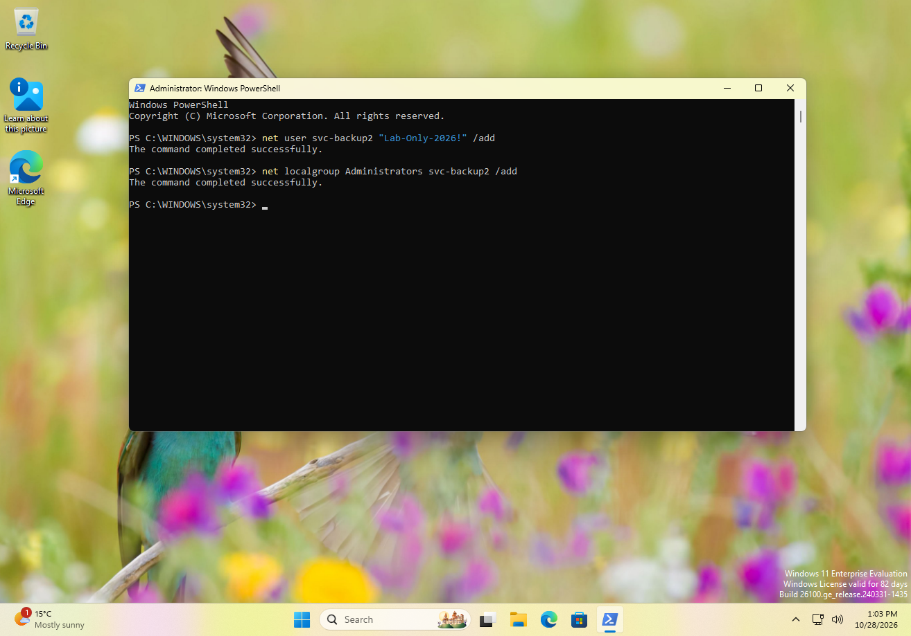
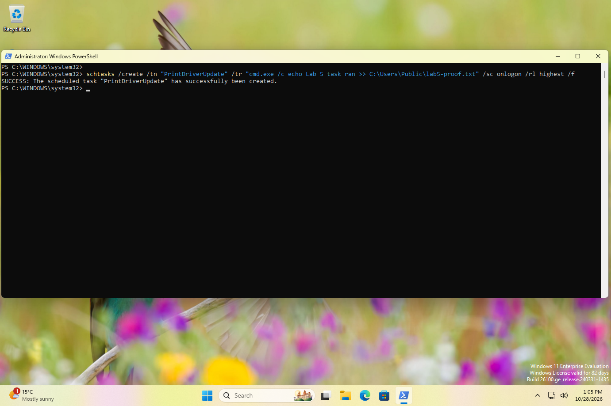
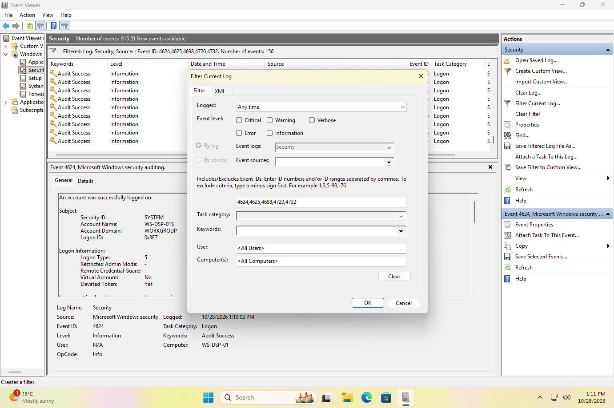

# My notes: Lab 5, Write it up

> ⚠️ Spoilers. Try [the lab](../../labs/level-1/05-write-it-up.md) first.

**Date done:** 2026-10-28
**Lab computer:** WS-DSP-01, Windows 11 Enterprise Evaluation (build 26100), VMware Workstation

> **At a glance**
>
> - **The goal:** play Labs 2 to 4 as one incident, then write one page about
>   it for a non-technical IT manager.
> - **My page:** [Incident summary: new admin account and a startup task on
>   WS-DSP-01](05-incident-report.md).
> - **Every time I wrote down matched the log** to the minute. That was the
>   thing I missed in Lab 4.
> - **The surprise:** the new account and the task were made by the sign-in
>   from 12:52 PM, before the guessing, not by the 1:02 PM unlock that followed
>   it. The log can't connect the guesser to the account.
> - **My first draft said we were "100% confident".** The evidence didn't
>   support that, and the final page says what the log can't show.

Screenshots are numbered in the order I took them. Times are Eastern Daylight
Time (UTC−4).

I reverted to my "Before Lab 4" snapshot first, so there was no svc-backup2
account and no PrintDriverUpdate task on the computer when I started.

---

## Part 1: Making one incident

| # | What I did | My note | Time in the log |
|---|---|---|---|
| 1 | Turned on task auditing | 12:55 | 12:55:27 PM (4719, audit policy changed) |
| 2 | Locked the screen | 12:56 | |
| 3 | Three wrong passwords, then the right one | 12:57, 12:58, 1:01, then 1:02 | 12:57:17, 12:58:30, 1:01:30 PM (4625), unlock 1:02:09 PM (4624) |
| 4 | Created svc-backup2 | 1:03 | 1:03:10 PM (4720) |
| 5 | Added it to Administrators | 1:03 | 1:03:20 PM (4732) |
| 6 | Created the PrintDriverUpdate task | 1:05 | 1:05:12 PM (4698) |
| 7 | Restarted, then signed in | 1:08, then 1:09 | sign-out 1:08:52 PM (4647), start 1:09:07 PM (4608), sign-in 1:09:09 PM (4624) |

Every note matched its record to the minute.

📸 Screenshot 1 (`lab5-1.png`): creating svc-backup2 and making it an admin, 1:03 PM

📸 Screenshot 2 (`lab5-2.png`): creating the task, 1:05 PM

## Part 2: The evidence

The three failed sign-ins all look the same: Dana's account, Logon Type 2 (at
the keyboard), Status `0xC000006D`, Sub Status `0xC000006A` (the account is
real, the password was wrong), Workstation WS-DSP-01, address `127.0.0.1`.

**Which sign-in made the account and the task?** This is the part I didn't
expect.

| Sign-in | Time | Logon IDs (admin / normal) | Used for |
|---|---|---|---|
| First sign-in | 12:52:06 PM | `0xA5B67` / `0xA5BA5` | **svc-backup2, the admin add and the task** (all `0xA5B67`) |
| Unlock after the guesses | 1:02:09 PM | `0x4231C3` / `0x4231F2` | nothing I could find |
| After the restart | 1:09:09 PM | `0x1C86B` / `0x1C8D2` | |
| 15 seconds later | 1:09:24 PM | `0xC0401` / `0xC0462` | |

The unlock wrote its own pair of records, but the commands I ran after it were
credited to the sign-in from 12:52 PM, even though I opened a fresh Terminal
(Admin) after the unlock (Screenshot 1 shows a new window). That's the same pattern as Lab 3, where
the delete reused the creation's Logon ID even though I'd locked and unlocked in
between. So the log shows the guessing, then work done by Dana's original
session. It doesn't show the guesser doing it.

**Background noise:** while I was typing wrong passwords, Windows created,
deleted and disabled its own "SoftLanding" tasks at 12:57:37 PM, and OneDrive
re-created its update task at 1:03:08 PM. Both name Dana as the Subject. Mine is
the one called `\PrintDriverUpdate`.

**Did the task run?** `lab5-proof.txt` has one line, "Lab 5 task ran", from the
sign-in after the restart. I didn't save `lab5-task.txt`, so I don't have
Windows' Last Run Time this time.

📸 Screenshot 3 (`lab5-3.png`): the filter for the evidence list, 156 records

## Part 3: My page

[Incident summary: new admin account and a startup task on WS-DSP-01](05-incident-report.md)

I wrote "What happened" and "How sure we are" first, then finished the
timeline, the evidence table, the gaps and the recommendations from the log.
Four things changed between my first draft and the final page:

1. **"We are 100% confident on what has happened."** The log proves what Dana's
   account did, not who did it, and it can't connect the guessing to the new
   account. The final page says exactly that.
2. **"The task runs with highest privileges regardless if the user has admin
   rights or not."** That's not what `HighestAvailable` means. It runs with the
   highest rights *the signed-in account* has. It doesn't give anyone admin
   rights they don't already have.
3. **"Eastern Standard Time."** On October 28 Toronto is still on daylight time,
   UTC−4. The log's own timestamps confirm it: 1:03:10 PM local is 17:03:10 UTC.
4. **"Shreya Lipare."** A typo in my own name.

## What surprised me

- **The unlock didn't own the work that came after it.** I expected the account
  and the task to carry the Logon ID from the 1:02 PM unlock, so the guesser
  would be tied to them. They carried the 12:52 PM sign-in's ID instead, even
  from a Terminal I opened after unlocking. In my logs, unlocking the
  screen didn't start a new working session. It let me back into the old one.
- **Writing it for someone outside IT was harder than finding it.** The facts
  took minutes. Saying them without event IDs, and without claiming more than
  the log shows, took the most time.
- **Turning on auditing is itself in the log.** My 12:55 PM change shows up as
  event 4719, so an investigator can see when recording started.

## What I missed, and noticed later

1. **My first draft overclaimed.** "100% confident" is the opposite of what
   Labs 2 to 4 taught: the log shows accounts, not people.
2. **I didn't save `lab5-task.txt`.** The proof file shows the task ran, but
   Windows' own Last Run Time would have been a second, separate source.
3. **Screenshot 3 shows the filter dialog, not the list.** The lab asked for
   the failures, the account records and the task record together in one view.
4. **I wrote "EST" without checking.** Daylight time was still on.

**Tip for next time:** before you write "how sure we are", list what the log
can't show. The honest version of the page is shorter than the confident one.

## What didn't match the lab page

Anything here gets fixed in the lab.

- The lab's example page said every step came from "the same sign-in". In my run
  the guessing and the unlock were one set of records, and the account and the
  task were another.
- The lab numbered the evidence list as Screenshot 1. I also captured the
  account and task commands, which made the page easier to back up.
- The lab didn't warn that Windows' own SoftLanding tasks appear in the 4698
  list too.
- The lab's tip about time zones didn't mention daylight time.

## Evidence files

- [lab5-incident.evtx](evidence/lab5-incident.evtx): 164 records filtered to
  4624, 4625, 4698, 4720 and 4732, ending 1:11:36 PM on 2026-10-28.
- [lab5-complete-log.evtx](evidence/lab5-complete-log.evtx): the whole Security
  log, 915 records, ending 1:10:21 PM. It adds the audit change (4719), the
  sign-out and restart (4647, 1100, 4608) and the account's neighbor records.
- [lab5-admins.txt](evidence/lab5-admins.txt): the Administrators group after
  the incident: Administrator, Dana and svc-backup2.
- [lab5-proof.txt](evidence/lab5-proof.txt): the task's output, one line.

## Screenshots

| # | File | Lab part | What it shows |
|---|---|---|---|
| 1 | `lab5-1.png` | Part 1, steps 4 and 5 | creating svc-backup2 and making it an admin |
| 2 | `lab5-2.png` | Part 1, step 6 | creating the PrintDriverUpdate task |
| 3 | `lab5-3.png` | Part 2 | the evidence filter over the Security log |
