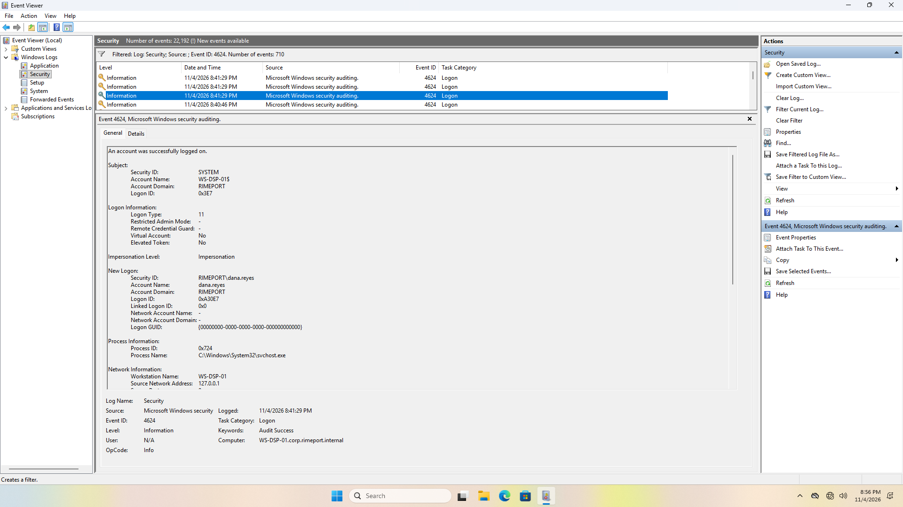
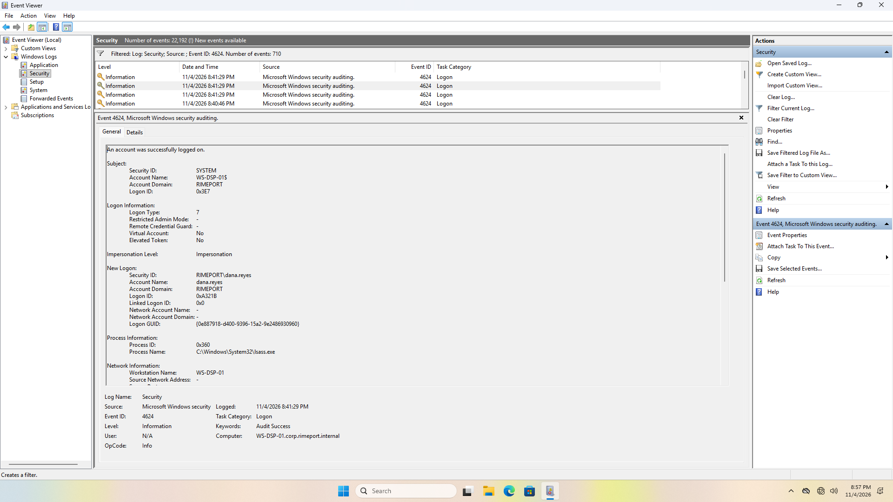
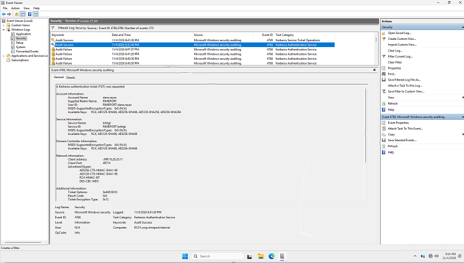
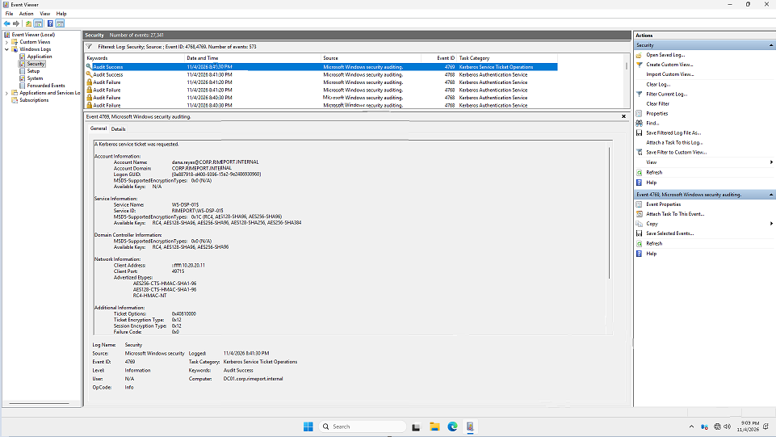
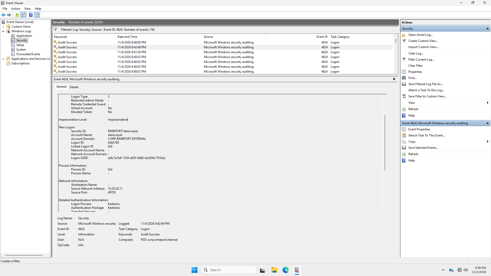
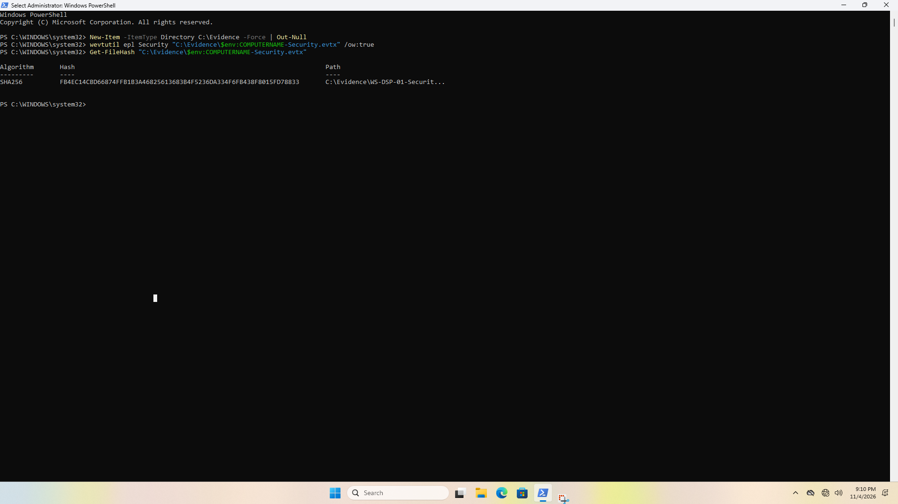
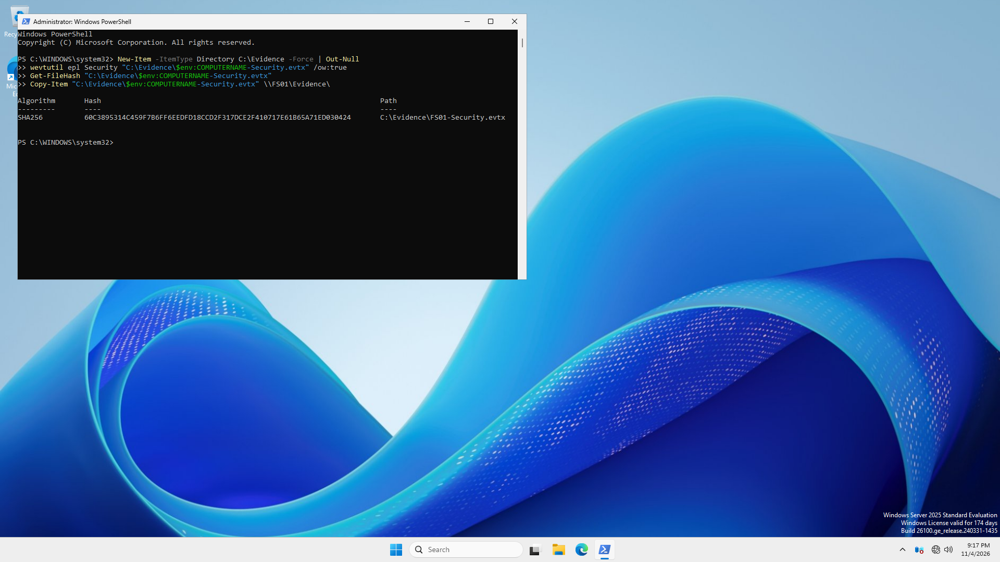
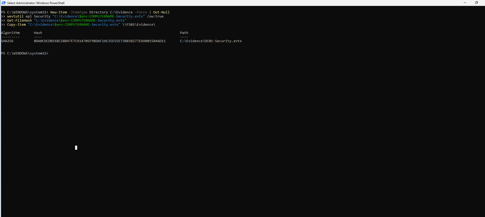
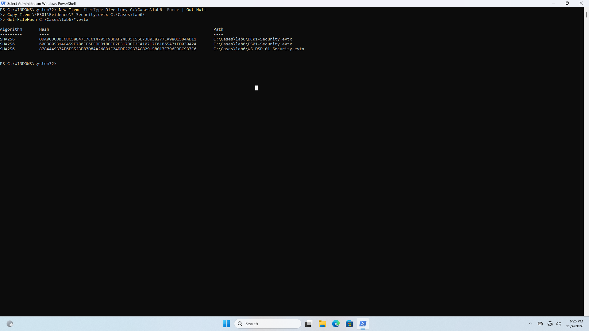
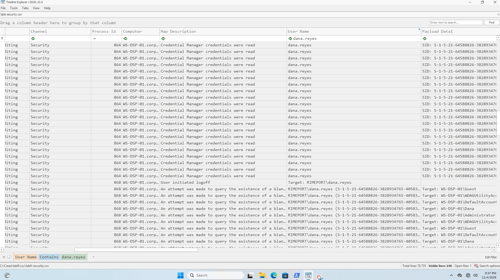

# My notes: Lab 6, Meet the network

> ⚠️ Spoilers. Try [the lab](../../labs/level-2/06-meet-the-network.md) first.

**Date done:** 2026-11-04
**Machines:** DC01 and FS01 (Windows Server 2025 Standard Evaluation, build
26100), WS-DSP-01, WS-FIN-01 and WS-IT-01 (Windows 11 Enterprise Evaluation),
on the Rimeport LAN segment in VMware Workstation

> **At a glance**
>
> - **The goal:** see which machines write down one normal sign-in and one
>   shared folder.
> - **Three machines wrote it down.** Dana's PC wrote her sign-in, DC01 wrote
>   her tickets, and FS01 wrote her network sign-in when she opened Dispatch.
> - **Her sign-in wasn't the Logon Type 2 I expected.** It was a Type 11 and a
>   Type 7 in the same second. My own responder sign-ins were Type 2.
> - **She got four kinds of ticket.** Only the 4769 for `FS01$` matches
>   opening the share. My Screenshot 4 is a different one.
> - **My first Timeline Explorer filter missed all of her sign-ins.** Filtering
>   **User Name** showed 248 rows from WS-DSP-01 only. Her name is in
>   **Payload Data1**.
> - **I'm in the logs a lot.** 342 records mention `responder` in one hour,
>   including five wrong passwords.
> - **I made mistakes, and most of them are in the logs too.**

Screenshots are numbered in the order the lab asks for them. Each one sits
under the part where the lab first asks for it. Times are Eastern (EST). Times
"from the log" come from the three Security logs I collected.

---

## Part 1: Get ready

| Machine | Started |
|---|---|
| DC01 | 8:36 PM |
| FS01 | 8:37 PM |
| WS-DSP-01 | 8:38 PM |
| WS-FIN-01 | 8:38 PM |
| WS-IT-01 | 8:38 PM |

## Part 2: Check what's being written down

I signed in to DC01 as `RIMEPORT\Administrator` at **8:38:18 PM** (4624,
Logon Type 2), not as `responder` the way the lab says. I didn't take
Screenshot 1, so I have no record of what `auditpol` showed. DC01's log does
have 4768 and 4769 records for the whole run, so Kerberos Authentication
Service and Kerberos Service Ticket Operations were being recorded.

## Part 3: A normal morning

At 8:40 PM I typed `RIMEPORT/dana.reyes` and entered the password twice,
maybe three times. It didn't work until I realized it's `RIMEPORT\dana.reyes`,
with a backslash, not a forward slash. The log has two failures, at 8:40:29
and 8:41:19 PM, both for the account `RIMEPORT\RIMEPORT/dana.reyes`, "user
name does not exist".

| # | Machine | Signed in as | What I did | My time | From the log |
|---|---|---|---|---|---|
| 1 | WS-DSP-01 | `RIMEPORT\dana.reyes` | Signed in | 8:41 PM | 8:41:29 PM, 4624 on WS-DSP-01 |
| 2 | WS-DSP-01 | `RIMEPORT\dana.reyes` | Opened `\\FS01\Dispatch` in File Explorer | 8:43 PM | 8:42:49 PM, 4624 on FS01 |
| 3 | WS-DSP-01 | `RIMEPORT\dana.reyes` | Opened `route-plan-north-yard.csv` in Notepad, read it, closed it | 8:43 PM | not recorded |
| 4 | WS-DSP-01 | `RIMEPORT\dana.reyes` | Signed out | 8:43 PM | 8:44:07 PM, 4647 on WS-DSP-01 |
| 5 | WS-FIN-01 | `RIMEPORT\owen.tran` | Signed in | 8:44 PM | 8:44:20 PM, 4768 on DC01 |
| 6 | WS-FIN-01 | `RIMEPORT\owen.tran` | Opened `\\FS01\Finance` and `invoices-october.csv` in Notepad | 8:45 to 8:46 PM | 8:46:06 PM, 4624 on FS01 |
| 7 | WS-FIN-01 | `RIMEPORT\owen.tran` | Signed out | 8:46 PM | not collected (I didn't export WS-FIN-01's log) |

## Part 4: Follow Dana across three machines

I had a failed sign-in at 8:50 PM, then signed in successfully as Dana again.
Then I realized I should have signed in as responder on WS-DSP-01, so I signed
out as Dana at 8:51 PM.

The log agrees: a wrong password for `dana.reyes` at **8:49:56 PM** (4625 on
WS-DSP-01 and 4771 on DC01), her sign-in at **8:50:07 PM**, and her sign-out at
**8:51:41 PM**.

I typed the wrong password for `RIMEPORT\responder` on WS-DSP-01 before I
signed in successfully. My notes say four times and 8:53 PM. The log shows
three failures at 8:52:00, 8:52:20 and 8:52:33 PM, the sign-in at **8:52:44
PM**, and two more failures later, at 9:09:31 and 9:09:41 PM, before I signed
in again at 9:09:45 PM to collect the log.

| Sign-in | Machine | Account | Time, from the log |
|---|---|---|---|
| Part 2 | DC01 | Administrator | 8:38:18 PM |
| Part 4 | WS-DSP-01 | responder | 8:52:44 PM |
| Part 4 | DC01 | responder | 9:00:23 PM |
| Part 4 | FS01 | responder | 9:05:44 PM |
| Part 5 | WS-DSP-01 | responder | 9:09:45 PM |

### Her computer: WS-DSP-01

Dana's sign-in showed up as two 4624 records:

| Field | First record | Second record |
|---|---|---|
| Logon Type | **11** | **7** |
| Account Name | dana.reyes | dana.reyes |
| Account Domain | RIMEPORT | RIMEPORT |
| Logon ID | `0xA30E7` | `0xA321B` |
| Process Name | `C:\Windows\System32\svchost.exe` | `C:\Windows\System32\lsass.exe` |
| Logon Process | User32 | Negotiat |
| Authentication Package | Negotiate | Negotiate |
| Workstation Name | WS-DSP-01 | WS-DSP-01 |
| Source Network Address | 127.0.0.1 | - |

📸 Screenshot 2.1 (`lab6-2.1.png`): the Logon Type 11 record

📸 Screenshot 2.2 (`lab6-2.2.png`): the Logon Type 7 record

### The domain controller: DC01

Signed in as `RIMEPORT\responder` at 9:00 PM on DC01. Reviewed 4768 and 4769.

- 4768 for dana.reyes: Client Address `::ffff:10.20.20.11`
- 4769 for Dana: Service Name `WS-DSP-01$`

📸 Screenshot 3 (`lab6-3.png`): Dana's 4768

📸 Screenshot 4 (`lab6-4.png`): a 4769 for Dana, Service Name `WS-DSP-01$`.
It's from her sign-in, not from opening the share. The one for step 2 is the
4769 for `FS01$` at 8:42:49 PM (question 3).

### The file server: FS01

Signed in as `RIMEPORT\responder` at 9:06 PM on FS01. Reviewed 4624.

📸 Screenshot 5 (`lab6-5.png`): Dana's sign-in on FS01

## Part 5: Same answer, another tool

### Collect the logs

My first try on DC01 failed. I typed `Net-Item` instead of `New-Item` and
`C:\Evidenc` instead of `C:\Evidence`, so the folder was never made and
`wevtutil` had nowhere to save. The second try worked.

| File | From | Saved | SHA-256 when collected | SHA-256 on WS-IT-01 | Match? |
|---|---|---|---|---|---|
| `DC01-Security.evtx` | DC01 | 9:16 PM | `0DA0CDCDBE68C58B47E7C614705F9BDAF24E35E55E73B038277EA98015B4AD11` | `0DA0CDCDBE68C58B47E7C614705F9BDAF24E35E55E73B038277EA98015B4AD11` | Yes |
| `FS01-Security.evtx` | FS01 | 9:11 PM | `60C3895314C459F7B6FF6EEDFD18CCD2F317DCE2F410717E61B65A71ED030424` | `60C3895314C459F7B6FF6EEDFD18CCD2F317DCE2F410717E61B65A71ED030424` | Yes |
| `WS-DSP-01-Security.evtx` | WS-DSP-01 | 9:10 PM, then again about 9:25 PM | `FB4EC14CBD66874FFB1B3A46825613683B4F5236DA334F6FB438F8015FD78833` | `8784A4937AF6E5523D87D8AA268B1F24DDF27537AC829158017C796F3BC9B7C6` | **No** |

**Why WS-DSP-01's didn't match:** I hashed one export and copied another.
Screenshot 6.1 is the export at 9:10 PM, and I didn't run `Copy-Item` then.
The copy that reached WS-IT-01 holds records up to 9:22:58 PM, and the file
was saved at 9:25:36 PM. So the export ran a second time, overwrote the first
file (`/ow:true`), and that second file is the one I copied. A new export is a
new file, so it has a new hash. Nothing was tampered with, but I never wrote
down the hash of the file I actually copied, so I can't prove the copy is
exactly what WS-DSP-01 saved.

📸 Screenshot 6.1 (`lab6-6.1.png`): WS-DSP-01's first export and hash, 9:10 PM

📸 Screenshot 6.1.1 (`lab6-6.1.1.png`): FS01's export, hash and copy

📸 Screenshot 6.1.3 (`lab6-6.1.3.png`): DC01's export, hash and copy

### Check the copies on my computer

WS-IT-01's clock reads **6:25 PM** in this screenshot. That's 9:25 PM Eastern:
WS-IT-01 was on Pacific time. By Screenshot 7, twelve minutes later, its clock
read 9:37 PM, so it had been switched to Eastern by then.

📸 Screenshot 6.2 (`lab6-6.2.png`): the three hashes on WS-IT-01

### Turn the logs into one timeline

I'd forgotten the EvtxECmd path from setup. EvtxECmd made the CSV at 9:26 PM:
70,735 rows from the three logs.

I filtered **User Name** for `dana.reyes`, the way the lab said then. It showed
248 rows, all from WS-DSP-01: Credential Manager reads (5379), blank-password
checks (4797) and her sign-outs (4647). None of her sign-ins or tickets were
there. In those records, EvtxECmd puts her name in **Payload Data1**, after
`Target:`. The User Name column held the computer, such as `WS-DSP-01$`, or
`-\-`. Filtering Payload Data1 for `dana.reyes` finds them on all three
machines.

**Time zone:** Time Created is in UTC. Dana's sign-in at 8:41:29 PM shows as
**01:41:29 on November 5**, five hours later and on the next day.

📸 Screenshot 7 (`lab6-7.png`): Timeline Explorer filtered on User Name, which
shows WS-DSP-01's records only

### Compare the two methods

| Method | Same answer? | Time it took | What was easy | What was annoying |
|---|---|---|---|---|
| Event Viewer, on each machine | Yes: her 4624s, 4768, 4769s and FS01's 4624 | About 17 minutes, 8:51 to 9:08 PM | | |
| EvtxECmd and Timeline Explorer | Not with my User Name filter. Yes with Payload Data1 | About 27 minutes, 9:10 to 9:37 PM, with collecting and hashing | | I'd forgotten the EvtxECmd path |

## Questions

**1. Dana's sign-in on WS-DSP-01: Logon Type, Account Domain, Authentication
Package. Does the time match step 1? Is my responder sign-in the same?**

Two records at **8:41:29 PM**: Logon Type **11** and Logon Type **7**. Both say
Account Domain **RIMEPORT** and Authentication Package **Negotiate**. The time
matches step 1, which I wrote down as 8:41. Her second sign-in at 8:50:07 PM
was the same pair.

My `responder` sign-ins on the same machine, at 8:52:44 and 9:09:45 PM, were
each a pair of **Type 2** records. So no, they weren't the same. I expected
Type 2 for Dana too.

**2. Client Address on Dana's 4768, and which machine has it?**

`::ffff:10.20.20.11`, at 8:41:30 PM, one second after her sign-in. That's
10.20.20.11 written the IPv6 way, which is **WS-DSP-01** in the setup table.

**3. Dana's 4769s: which Service Names, and which one matches step 2?**

Four Service Names between 8:41 and 8:52 PM:

| Service Name | When |
|---|---|
| `WS-DSP-01$` | 8:41:30 PM, at her sign-in |
| `DC01$` | 8:41:30 PM and several more times |
| `FS01$` | **8:42:49 PM** |
| `krbtgt` | 8:44:08 PM |

The **`FS01$`** one matches step 2. I wrote 8:43 for opening Dispatch, and
FS01 recorded her sign-in in the same second, 8:42:49. It tells me she was
about to use something on FS01, but not which folder or file. My Screenshot 4
is the `WS-DSP-01$` one, the first 4769 I found.

**4. FS01: Logon Type, Source Network Address, Workstation Name. How did FS01
know who she was?**

Logon Type **3**, Source Network Address **10.20.20.11**, Workstation Name
**-** (empty), Authentication Package **Kerberos**, at 8:42:49 PM. She never
typed her password on FS01. Her computer showed FS01 the ticket DC01 had just
given her: the 4769 for `FS01$` at the same second.

**5. Owen's morning**

The same pattern, from **10.20.20.12** (WS-FIN-01):

| Time | Machine | Record |
|---|---|---|
| 8:44:20 PM | DC01 | 4768, Client Address `::ffff:10.20.20.12` |
| 8:44:20 PM | DC01 | 4769s for `WS-FIN-01$` and `DC01$` |
| 8:46:06 PM | DC01 | 4769 for `FS01$` |
| 8:46:06 PM | FS01 | 4624, Logon Type 3 from 10.20.20.12, then three more at 8:46:27 |

His sign-in on WS-FIN-01 itself isn't in my evidence, because I didn't collect
WS-FIN-01's log.

Method I'd pick, and why:

**6. A 4768 or 4769 whose account ends in $**

`WS-DSP-01$`, `WS-FIN-01$`, `WS-IT-01$`, `FS01$` and `DC01$` all ask DC01 for
tickets. Between 8:30 and 9:30 PM, **83 of DC01's 138** 4768 and 4769 records
were computers, about three in five. People: `responder` 28, Dana 14, Owen 7,
Administrator 2, plus 4 for the account name `RIMEPORT`.

**7. How many times does responder show up, and could I be mistaken for an
attacker?**

**342 records** across the three logs between 8:30 and 9:30 PM. Most are
Credential Manager reads (5379). The ones that matter:

| What | Where | How many |
|---|---|---|
| Sign-ins at the keyboard (4624, Type 2) | WS-DSP-01, DC01, FS01 | 4, 2 and 2: a pair each time |
| Network sign-ins (4624, Type 3) | DC01 27, FS01 1 | 28 |
| Wrong passwords | 4625 on WS-DSP-01, 4771 on DC01 | 5 of each |
| Tickets (4768 and 4769) | DC01 | 28 |

Plus my Administrator sign-in on DC01 at 8:38:18 PM.

Without my notes, this looks bad: five wrong passwords for an admin account,
then a success, then sign-ins on three machines in 13 minutes, then network
sign-ins to the file server. That's what an attacker guessing a password and
moving between computers would look like. My notes, with times, are the only
thing that says it was me.

**8. Did both methods find the same records for Dana?**

Not at first. Event Viewer found all of them on all three machines. My
Timeline Explorer filter on **User Name** found none of her sign-ins or
tickets, only 248 other records from WS-DSP-01. The tool wasn't missing the
records. I filtered the wrong column. Her name is in **Payload Data1**.

**9. Normal at Rimeport, in three sentences**

When Dana signed in at WS-DSP-01 at 8:41:29 PM, her computer wrote a Type 11
and a Type 7 sign-in, and a second later DC01 wrote a 4768 from 10.20.20.11
and 4769s for `WS-DSP-01$` and `DC01$`. When she opened `\\FS01\Dispatch` at
8:42:49 PM, DC01 wrote a 4769 for `FS01$` and FS01 wrote a Type 3 sign-in
from 10.20.20.11 in the same second. Neither DC01 nor FS01 wrote down which
file she opened.

---

## What surprised me

- **Dana's sign-in was Type 11 and Type 7, not Type 2.** Type 11 means signing
  in with saved credentials without asking the domain controller, yet DC01
  gave her a ticket one second later. My own sign-ins were plain Type 2 pairs.
- **One sign-in gave her four kinds of ticket.** Only one of them, `FS01$`,
  was about the shared folder.
- **DC01 wrote 16 network sign-ins for Dana**, even though she never opened
  anything on DC01 herself.
- **My typo is in the log, word for word:** `RIMEPORT\RIMEPORT/dana.reyes`,
  "user name does not exist".
- **One wrong password left records on two machines:** a 4625 on the PC and a
  4771 on DC01.
- **Timeline Explorer showed UTC,** so the date moved to the next day.
- **Filtering the obvious column found the wrong records.**
- **I'm the noisiest person in the logs.** 342 records in an hour.

## What I'd do differently next time

I made mistakes in this lab, and every one taught me something.

1. **Sign in as responder every time.** I used Administrator on DC01 for Part
   2, and signed in as Dana again on WS-DSP-01 for Part 4 before switching.
   The sign-in screen offers the last account used. Choose **Other user** and
   type the full name.
2. **Type the account name with a backslash:** `RIMEPORT\dana.reyes`, not
   `RIMEPORT/dana.reyes`.
3. **Keep my lab passwords in one place.** I kept them in each VM's
   description in VMware, forgot them after a break before Level 2, and typed
   responder's wrong five times.
4. **Check every machine's time zone first.** Two of my machines, WS-IT-01
   among them, were on Pacific time instead of Eastern, so the times I wrote
   while saving logs didn't line up. `Get-TimeZone` on each machine fixes it
   before it starts.
5. **Hash the file I copy.** I hashed WS-DSP-01's first export and copied the
   second, so I can't prove that copy.
6. **Paste commands instead of typing them.** `Net-Item` and `C:\Evidenc`
   broke my first export on DC01.
7. **Take screenshots from my real computer.** Copying one out of DC01 didn't
   work, and I missed Screenshot 1 completely.
8. **Write tool paths in my notes.** I'd forgotten where EvtxECmd was.
9. **Check what a column holds before filtering it.**

## What didn't match the lab page

All of these were fixed in the lab on 2026-11-04.

- The lab expected Dana's sign-in to be Logon Type 2. It was 11 and 7.
- The lab asked for "a 4769 near step 2". Dana has several, and the first one
  you find is the wrong one.
- The lab didn't say Timeline Explorer shows UTC.
- The lab said to filter **User Name** in Timeline Explorer. That misses her
  sign-ins and tickets. It now says **Payload Data1**.
- The lab didn't name the three machines for Part 4, or say which account to
  use at each sign-in.
- Setup never set a time zone on WS-FIN-01 and WS-IT-01.

## Evidence files

- [lab6-security-logs.zip](evidence/lab6-security-logs.zip): the three
  Security logs exactly as they reached WS-IT-01 (`DC01-Security.evtx`,
  `FS01-Security.evtx` and `WS-DSP-01-Security.evtx`). Unzip them and run
  `Get-FileHash`. Each should match the "on WS-IT-01" column above. FS01's
  older records carry its name from before setup, `WIN-514BOT0I3TO`.

The timeline CSV isn't here. At 76 MB it's too big, and EvtxECmd makes it again
from these three logs in under a minute.

## Screenshots

| # | File | Lab part | What it shows |
|---|---|---|---|
| 1 | not taken | Part 2 | |
| 2.1 | `lab6-2.1.png` | Part 4, WS-DSP-01 | Dana's 4624, Logon Type 11, 8:41:29 PM |
| 2.2 | `lab6-2.2.png` | Part 4, WS-DSP-01 | Dana's 4624, Logon Type 7, 8:41:29 PM |
| 3 | `lab6-3.png` | Part 4, DC01 | Dana's 4768, Client Address `::ffff:10.20.20.11` |
| 4 | `lab6-4.png` | Part 4, DC01 | a 4769 for Dana, Service Name `WS-DSP-01$` |
| 5 | `lab6-5.png` | Part 4, FS01 | Dana's 4624, Logon Type 3 from 10.20.20.11 |
| 6.1 | `lab6-6.1.png` | Part 5, collect | WS-DSP-01's first export and hash |
| 6.1.1 | `lab6-6.1.1.png` | Part 5, collect | FS01's export, hash and copy |
| 6.1.3 | `lab6-6.1.3.png` | Part 5, collect | DC01's export, hash and copy |
| 6.2 | `lab6-6.2.png` | Part 5, check | the three hashes on WS-IT-01, clock on Pacific time |
| 7 | `lab6-7.png` | Part 5, timeline | Timeline Explorer filtered on User Name |
