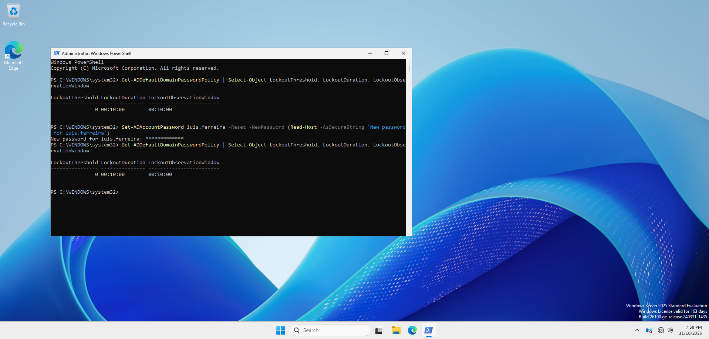
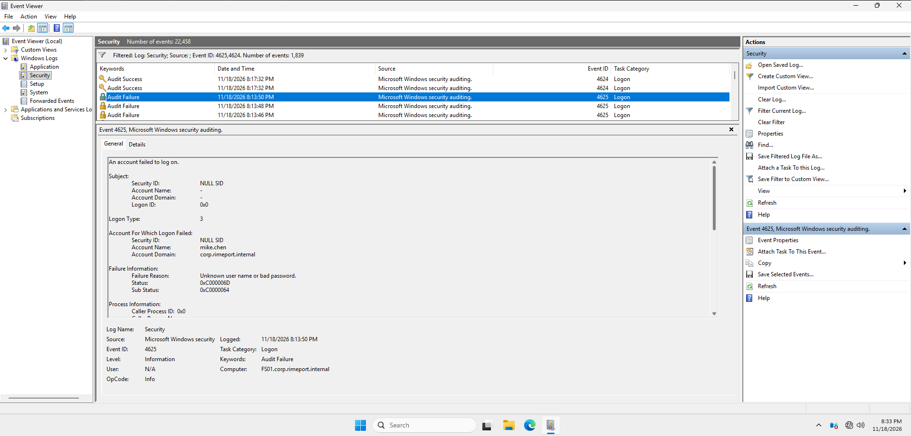
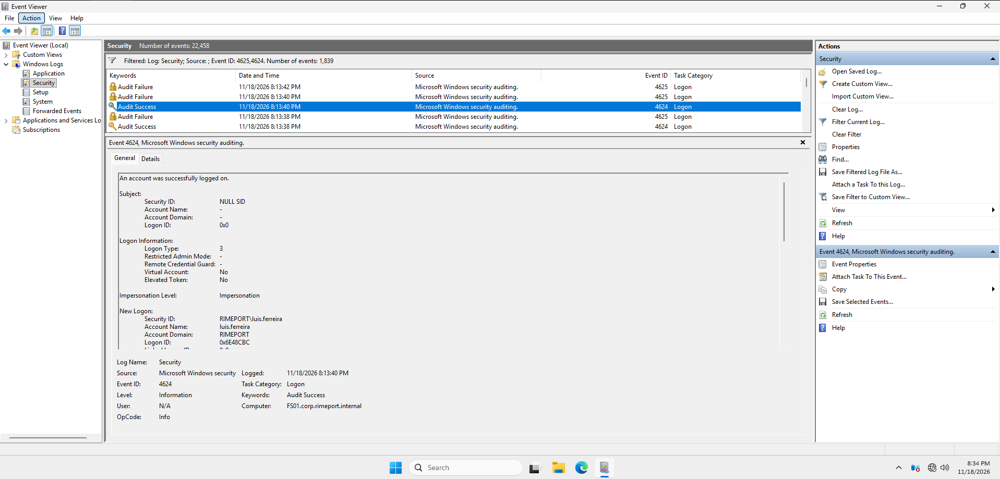
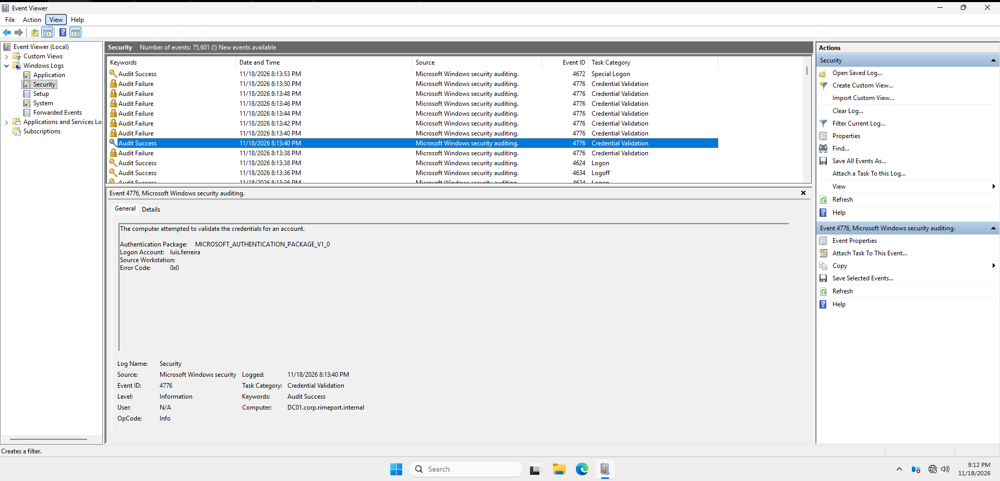
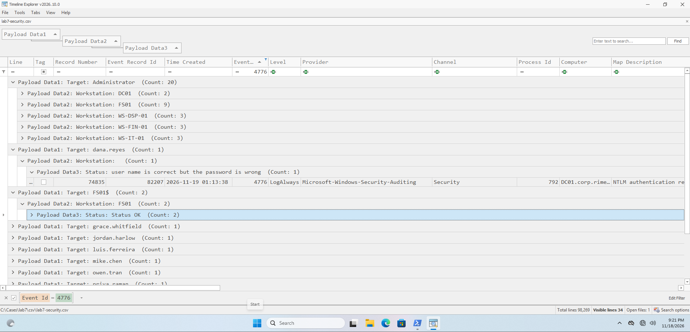

# My notes: Lab 7, Password spraying over the network

> ⚠️ Spoilers. Try [the lab](../../labs/level-2/07-password-spraying.md) first.

**Date done:** 2026-11-18
**Machines:** DC01 and FS01 (Windows Server 2025 Standard Evaluation, build
26100), WS-IT-01, and my Kali Linux VM (the 2026.2 VMware image) at
`10.20.99.50` on the Rimeport LAN segment

> **At a glance**
>
> - **The goal:** play the attacker, spray one password at Rimeport, then find
>   it in the logs.
> - **One guess worked.** `Rimeport2026!` got into `luis.ferreira` at
>   8:13:40 PM. Seven other names failed.
> - **The spray took 12 seconds, in 2-second steps.** Windows Server 2025
>   paused after every failure, but not after Luis's success.
> - **NetExec and the logs disagreed.** NetExec showed timeouts for every
>   failure. FS01 wrote down each one, with the reason.
> - **The attacker sent no name.** Workstation Name on FS01 and Source
>   Workstation on DC01 were both empty. Only FS01 had the address.
> - **`jordan.harlow` looked like any real account.** Disabled, but its
>   failure said "wrong password," not "disabled."

Screenshots are numbered in the order the lab asks for them. Each one sits
under the part where the lab first asks for it. Times are Eastern (EST). Kali's
clock showed the same time as the Windows machines.

---

## Part 2: Set up the weakness

| # | Machine | Signed in as | What I did | Time |
|---|---|---|---|---|
| 1 | DC01 | `RIMEPORT\responder` | Reset `luis.ferreira`'s password with `Set-ADAccountPassword` | 7:55 PM |
| 2 | DC01 | `RIMEPORT\responder` | Checked the lockout policy with `Get-ADDefaultDomainPasswordPolicy` | 7:58 PM |

**LockoutThreshold 0**, LockoutDuration 10 minutes, LockoutObservationWindow
10 minutes. With a threshold of 0, accounts never lock, so the other two
settings don't matter.



📸 Screenshot 1 (`lab7-1.png`): the lockout settings and the reset, 7:58 PM

## Part 3: Get the attacker ready

| # | Machine | Signed in as | What I did | Time |
|---|---|---|---|---|
| 3 | Kali | `kali` | Ran `nxc smb 10.20.10.20` to check FS01 answers | 8:11 PM |

NetExec answered with FS01's details before I tried any password:

```
Windows 11 / Server 2025 Build 26100 x64 (name:FS01) (domain:corp.rimeport.internal) (signing:True) (SMBv1:None)
```

📸 Screenshot 2: I pasted it into my notes but didn't save it as a file, so
it isn't here. The same line is the first line of NetExec's output in
Screenshot 3.

## Part 4: The spray

| # | Machine | Signed in as | What I did | Time |
|---|---|---|---|---|
| 4 | Kali | `kali` | Made `users.txt` with the eight names | 8:12 PM |
| 5 | Kali | `kali` | Sprayed `Rimeport2026!` at all eight names on FS01 | 8:13 PM |

NetExec printed one `[+]` line, for `corp.rimeport.internal\luis.ferreira`.
Every other line said `Connection Error: The NETBIOS connection with the remote
host timed out.` From the attacker's side, it looked like the network was
flaky. FS01's log says otherwise (Part 5).

![Kali terminal: users.txt, then nxc smb with --continue-on-success; [+] for luis.ferreira, Connection Error lines for the rest](images/lab7-3.png)

📸 Screenshot 3 (`lab7-3.png`): the list and NetExec's output, Kali clock
8:14 PM

## Part 5: What FS01 saw

Event Viewer on FS01, Security log, filtered for 4625 and 4624, searched for
`10.20.99.50`. Every record from that address had Logon Type **3**,
Authentication Package **NTLM**, an **empty** Workstation Name, and Source
Network Address **10.20.99.50**.

| Time | Event | Account | Failure Reason | Status | Sub Status |
|---|---|---|---|---|---|
| 8:13:38 PM | 4625 | dana.reyes | Unknown user name or bad password. | `0xC000006D` | `0xC000006A` |
| 8:13:40 PM | **4624** | **luis.ferreira** | (signed in) | | |
| 8:13:40 PM | 4625 | owen.tran | Unknown user name or bad password. | `0xC000006D` | `0xC000006A` |
| 8:13:42 PM | 4625 | grace.whitfield | Unknown user name or bad password. | `0xC000006D` | `0xC000006A` |
| 8:13:44 PM | 4625 | sam.okafor | Unknown user name or bad password. | `0xC000006D` | `0xC000006A` |
| 8:13:46 PM | 4625 | priya.raman | Unknown user name or bad password. | `0xC000006D` | `0xC000006A` |
| 8:13:48 PM | 4625 | jordan.harlow | Unknown user name or bad password. | `0xC000006D` | `0xC000006A` |
| 8:13:50 PM | 4625 | mike.chen | Unknown user name or bad password. | `0xC000006D` | **`0xC0000064`** |

Only `mike.chen` has a different Sub Status: `0xC0000064`, an account that
doesn't exist. Everyone else, including the disabled `jordan.harlow`, got
`0xC000006A`, a real account with a wrong password.

**Event Viewer's Find:** it searches down from the record you've selected. I
had a record selected from after the spray, and Find didn't find anything until
I started from the top.



📸 Screenshot 4 (`lab7-4.png`): the 4625 for `mike.chen`, 8:13:50 PM



📸 Screenshot 5 (`lab7-5.png`): the 4624 for `luis.ferreira`, 8:13:40 PM

## Part 6: What DC01 saw

Event Viewer on DC01, Security log. Eight **4776** records (Credential
Validation) from 8:13:38 to 8:13:50 PM, one per name, two seconds apart, with
Luis's and Owen's both at 8:13:40.

| Account | Error Code | Where it comes from |
|---|---|---|
| `luis.ferreira` | **`0x0`** (no error) | Screenshot 6 |
| `mike.chen` | `0xC0000064` | my notes |
| `dana.reyes` | "user name is correct but the password is wrong" | Timeline Explorer, Screenshot 7 |
| the other five | not recorded | |

**Source Workstation was empty** on Luis's 4776, and on Dana's in Timeline
Explorer. A 4776 has no address field at all, so DC01 can't say where the
attempts came from.



📸 Screenshot 6 (`lab7-6.png`): the 4776 for `luis.ferreira`, Error Code `0x0`

## Part 7: Same answer, another tool

On WS-IT-01, EvtxECmd turned the FS01 and DC01 logs into
`C:\Cases\lab7\csv\lab7-security.csv`: 98,269 rows. In Timeline Explorer I
filtered Event Id **4776** and grouped by **Payload Data1**, then **Payload
Data2**, then **Payload Data3**. That gave every account, its workstation and
its result, with counts.

Each sprayed name had **one** 4776, the same as Event Viewer. The 4776 history
also had 20 checks for `Administrator`, from the domain joins in setup, and 2
for `FS01$`. Those aren't the spray, so the time window matters. **Time
Created** was in UTC: `dana.reyes` showed as `2026-11-19 01:13:38`, which is
8:13:38 PM Eastern on November 18.



📸 Screenshot 7 (`lab7-7.png`): Timeline Explorer, 4776 grouped three levels
deep

### Compare the two methods

| Method | Same answer? | Time it took | What was easy | What was annoying |
|---|---|---|---|---|
| Event Viewer, on FS01 and DC01 | Yes: every guess, with its result | | | **Find** only searches down from the selected record |
| EvtxECmd and Timeline Explorer | Yes: one 4776 per sprayed name | | | |

## Questions

**1. Which accounts were tried, in what order, and how many seconds from the
first guess to the last?**

All eight in `users.txt`, in that order: dana.reyes, luis.ferreira, owen.tran,
grace.whitfield, sam.okafor, priya.raman, jordan.harlow and mike.chen. From
8:13:38 to 8:13:50 PM on FS01, **12 seconds**. Windows Server 2025 put a
2-second gap after every failure, but not after the successful sign-in: Owen's
attempt came in the same second as Luis's success.

**2. On FS01, what Source Network Address and Workstation Name do the
failures show? Is that one of Rimeport's machines?**

`10.20.99.50`, with the Workstation Name **blank**. It isn't one of Rimeport's
machines: servers are `10.20.10.x` and staff PCs `10.20.20.x`. It's my Kali VM.

**3. Which Sub Status codes did the failures have? Which accounts got a
different code, and what does that tell you?**

`mike.chen` got `0xC0000064` (the user name doesn't exist). Every other failure
got `0xC000006A` (the user name exists, but the password was wrong). That
includes `jordan.harlow`, even though his account is disabled. So the log tells
anyone reading it which names are real at Rimeport, but not that Jordan's
account is switched off.

**4. Did any guess work? Which account, at what time, and which record proves
it on FS01? What does DC01 show for the same moment?**

Yes: `luis.ferreira` at **8:13:40 PM**. FS01's **4624** proves it: Logon Type
3, NTLM, from `10.20.99.50`. DC01 logged a **4776** for `luis.ferreira` in the
same second, with Error Code **`0x0`**.

**5. What does DC01's 4776 tell you that FS01's 4625 doesn't? And what does it
leave out?**

It confirms DC01 itself checked each password, and gives the result of each
check (`0x0` for Luis, `0xC0000064` for `mike.chen`). What it leaves out is
where the attempt came from: Source Workstation was empty, and a 4776 has no
address field. Only FS01's records have `10.20.99.50`, so I need both logs.

**6. Why didn't any account lock? Would a threshold of 10 have locked any
account?**

The lockout threshold is 0, so accounts never lock. A threshold of 10
wouldn't have locked any account either, because the spray tried only one
password on each account.

**7. How is this different from the guessing in Lab 2? What would the same
attack look like with 10 passwords instead of 1?**

Lab 2 was one account and many passwords, typed at the keyboard (Logon Type 2,
from `127.0.0.1`). This was many accounts and one password, over the network
(Logon Type 3, from `10.20.99.50`). With 10 passwords, each account would get
up to 10 failures, about 80 tries in all, and the 2-second pauses would stretch
it to around two and a half minutes. With a threshold of 10, every account
would lock.

**8. Did Event Viewer and Timeline Explorer count the same guesses for each
account?**

Yes: one per sprayed name in both. Timeline Explorer also showed older checks
for other accounts, like `Administrator` from setup, because I imported the
whole Security logs.

**9. In two sentences for Priya: what happened, and the first thing Rimeport
should do about it.**

At 8:13 PM, a machine that isn't ours, at `10.20.99.50`, tried the password
`Rimeport2026!` against eight Rimeport accounts on the file server, and it
worked for Luis Ferreira's account. Reset Luis's password now, then check what
his account did after 8:13:40 PM.

---

## What surprised me

- **The attacker's tool and the log told different stories.** NetExec showed
  "timed out" for every failure, while FS01 recorded each one with the exact
  reason.
- **A success is easy to spot by its timing.** Every failure was followed by a
  2-second pause. Luis's success wasn't.
- **The disabled account didn't look disabled.** `jordan.harlow` got the same
  "wrong password" code as everyone else.
- **Nobody's name was attached.** Both Workstation Name and Source Workstation
  were empty. The only thing pointing at the attacker was FS01's
  `10.20.99.50`.
- **The DC's history was busy.** 20 NTLM checks for `Administrator` from the
  domain joins in setup sat in the same list as the spray.

## What I'd do differently next time

1. **Save every screenshot as a file.** I pasted Screenshot 2 into my notes and
   never saved it, so only a small copy exists.
2. **Write down every 4776 error code,** not just two. I have them for Luis,
   Mike and Dana only.
3. **Write down the hashes** when I collect the logs. I made the timeline but
   didn't record the hashes, so I can't show the copies match.
4. **Get the order right.** My first answer to question 9 said a compromised
   account ran the spray. It's the other way round: the spray is what found
   Luis's password.
5. **Start Event Viewer's Find from the top record.**

## What didn't match the lab page

Each of these was fixed in the lab on 2026-11-18.

- The lab said NetExec prints one line per account. It did, but the failures
  said "Connection Error … timed out," not a failed sign-in.
- The lab guessed `jordan.harlow` might get `0xC0000072` (disabled). He got
  `0xC000006A`.
- The lab didn't know what Workstation Name and Source Workstation would show.
  Both were empty.
- The lab didn't say that **Find** searches down from the selected record.

## Evidence files

None for this lab. The logs I collected stayed in `C:\Cases\lab7` on WS-IT-01,
and I didn't record their hashes.

## Screenshots

| # | File | Lab part | What it shows |
|---|---|---|---|
| 1 | `lab7-1.png` | Part 2 | lockout settings (threshold 0) and Luis's reset, 7:58 PM |
| 2 | not saved | Part 3 | NetExec's check of FS01, pasted into my notes only |
| 3 | `lab7-3.png` | Part 4 | `users.txt` and NetExec's spray output |
| 4 | `lab7-4.png` | Part 5 | 4625 for `mike.chen`, Sub Status `0xC0000064` |
| 5 | `lab7-5.png` | Part 5 | 4624 for `luis.ferreira`, Logon Type 3 |
| 6 | `lab7-6.png` | Part 6 | 4776 for `luis.ferreira`, Error Code `0x0` |
| 7 | `lab7-7.png` | Part 7 | Timeline Explorer, 4776 grouped by account, workstation and result |
