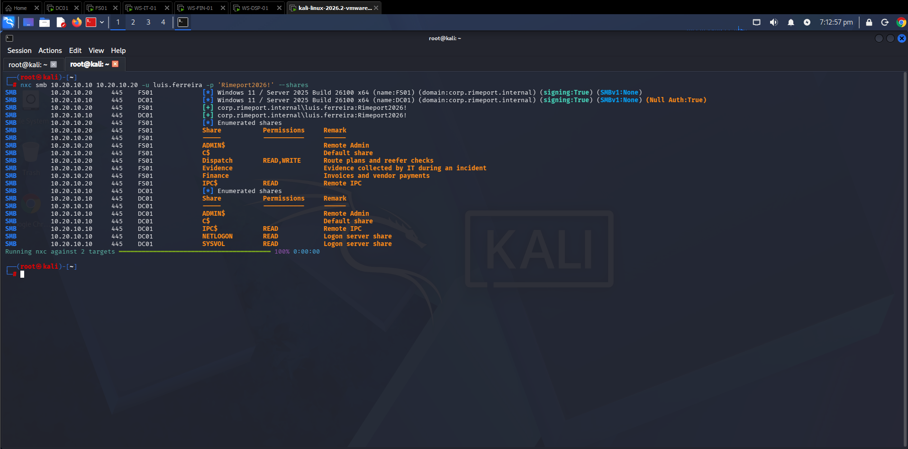
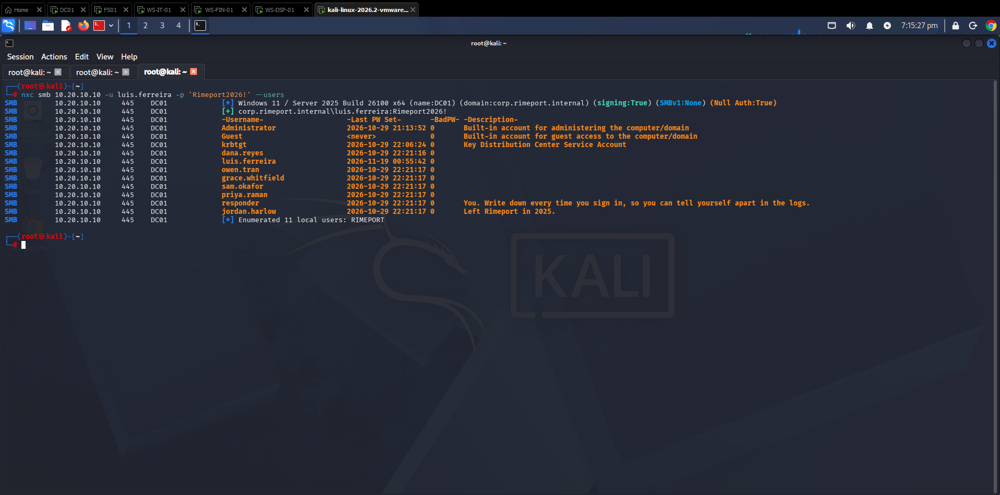
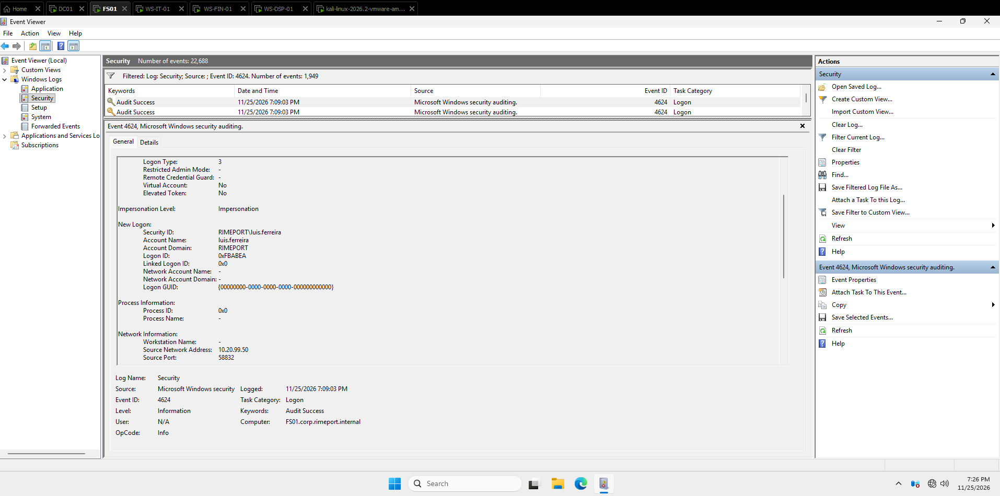
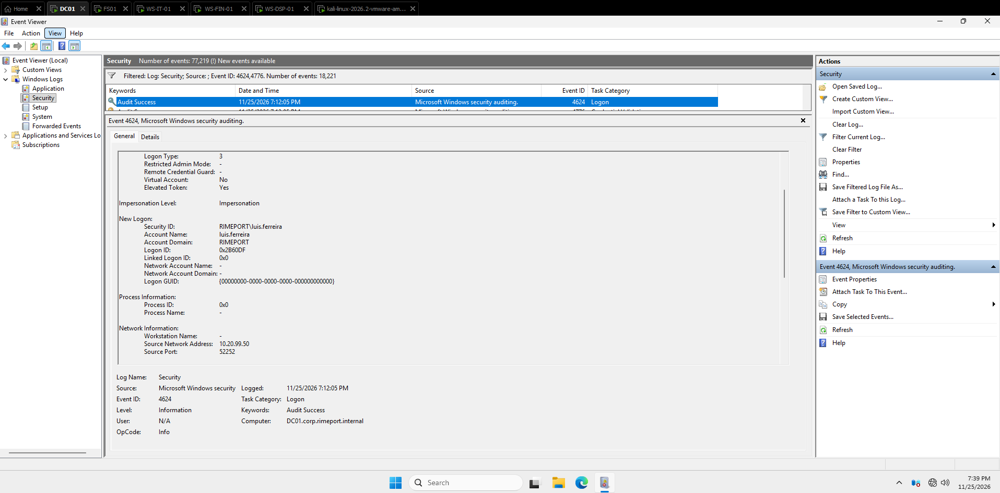
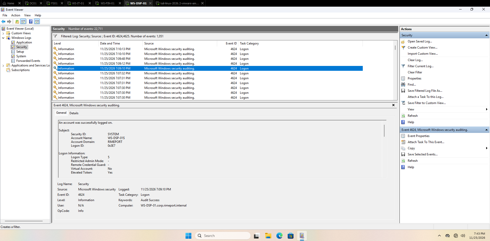
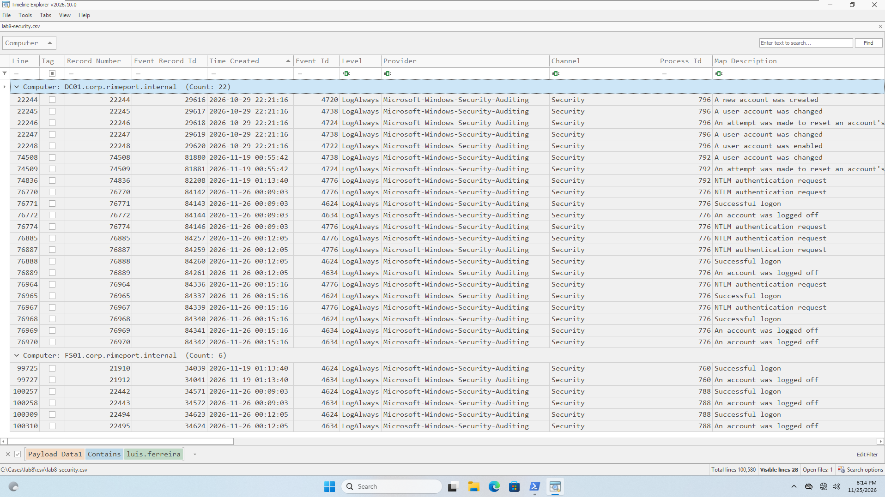

# My notes: Lab 8, Moving sideways

> ⚠️ Spoilers. Try [the lab](../../labs/level-2/08-moving-sideways.md) first.

**Date done:** 2026-11-25
**Machines:** DC01 and FS01 (Windows Server 2025, build 26100), WS-DSP-01,
WS-FIN-01, WS-IT-01, and my Kali Linux VM (the 2026.2 VMware image) at
`10.20.99.50` on the Rimeport LAN segment

> **At a glance**
>
> - **The goal:** use Luis's stolen password the way an attacker would, then
>   follow his account across Rimeport.
> - **Two machines let him in:** DC01 and FS01. NetExec printed nothing at all
>   for the three PCs, and their logs had nothing from `10.20.99.50`.
> - **What the account could see:** the Dispatch folder (read and write),
>   NETLOGON and SYSVOL, and the name of every account in the domain.
> - **Six sign-ins, six checks.** Kali signed in to DC01 four times and FS01
>   twice. DC01 checked the password six times (4776), one for each.
> - **It looked different from a real PC.** NTLM from `10.20.99.50`, where
>   Dana's real sign-in in Lab 6 was Kerberos from `10.20.20.11`.
> - **Nobody stayed signed in.** Every sign-in logged off in the same second.

Screenshots are numbered in the order the lab asks for them. Each one sits
under the part where the lab first asks for it. Times are Eastern (EST):
Timeline Explorer's UTC times are five hours ahead of Event Viewer's for the
same records. Kali's clock lined up with the Windows machines.

---

## Part 1: Get ready

| # | Machine | Signed in as | What I did | Time (EST) |
|---|---|---|---|---|
| 1 | DC01 | `RIMEPORT\responder` | Signed in | 7:03 PM |
| 2 | FS01 | `RIMEPORT\responder` | Signed in | 7:03 PM |
| 3 | WS-DSP-01 | `RIMEPORT\responder` | Signed in | 7:04 PM |
| 4 | WS-FIN-01 | `RIMEPORT\responder` | Signed in | 7:04 PM |
| 5 | WS-IT-01 | `RIMEPORT\responder` | Signed in | 7:04 PM |
| 6 | Kali | `kali` | Signed in | 7:05 PM |

I didn't go back to **rimeport-ready** this time. I started from where Lab 7
left off, so Luis's password was still `Rimeport2026!` from Lab 7's reset
(November 18, 7:55:42 PM), and I didn't need to set it again. Lab 7's
records were still in DC01's and FS01's logs too.

## Part 2: Use Luis's account

The Kali terminal was a root shell (`root@kali`), so the commands ran as root.

| # | Machine | Signed in as | What I did | Time (EST) |
|---|---|---|---|---|
| 7 | Kali | `root` | Tried Luis's password on all five Windows machines | 7:09 PM |
| 8 | Kali | `root` | Listed the shares on DC01 and FS01 (`--shares`) | 7:12 PM |
| 9 | Kali | `root` | Asked DC01 for every account (`--users`) | 7:15 PM |

### Where does the password work?

```
nxc smb 10.20.10.10 10.20.10.20 10.20.20.11 10.20.20.12 10.20.20.30 -u luis.ferreira -p 'Rimeport2026!'
```

It was NetExec's first run on this Kali, so it printed a block of
`[*] Creating ...` lines while it set itself up. Then:

```
SMB  10.20.10.10  445  DC01  [*] Windows 11 / Server 2025 Build 26100 x64 (name:DC01) (domain:corp.rimeport.internal) (signing:True) (SMBv1:None) (Null Auth:True)
SMB  10.20.10.20  445  FS01  [*] Windows 11 / Server 2025 Build 26100 x64 (name:FS01) (domain:corp.rimeport.internal) (signing:True) (SMBv1:None)
SMB  10.20.10.10  445  DC01  [+] corp.rimeport.internal\luis.ferreira:Rimeport2026!
SMB  10.20.10.20  445  FS01  [+] corp.rimeport.internal\luis.ferreira:Rimeport2026!
```

`[+]` for DC01 and FS01, with no `Pwn3d!`. Nothing at all for `10.20.20.11`,
`10.20.20.12` or `10.20.20.30`, though the progress bar said it ran against 5
targets.

![Kali terminal: nxc against five addresses; [+] for DC01 and FS01, no lines for the three PCs, Kali clock 7:09:26 PM](images/lab8-1.png)

📸 Screenshot 1 (`lab8-1.png`): NetExec's answer for all five machines

### What can Luis open?

| Server | Share | Luis's access | Description NetExec showed |
|---|---|---|---|
| FS01 | `Dispatch` | **READ, WRITE** | Route plans and reefer checks |
| FS01 | `IPC$` | READ | Remote IPC |
| FS01 | `Finance` | none | Invoices and vendor payments |
| FS01 | `Evidence` | none | Evidence collected by IT during an incident |
| FS01 | `ADMIN$`, `C$` | none | Remote Admin, Default share |
| DC01 | `NETLOGON` | READ | Logon server share |
| DC01 | `SYSVOL` | READ | Logon server share |
| DC01 | `IPC$` | READ | Remote IPC |
| DC01 | `ADMIN$`, `C$` | none | Remote Admin, Default share |

NetExec listed every share with its description, even the ones Luis can't
open.



📸 Screenshot 2 (`lab8-2.png`): the share lists for DC01 and FS01

### Who works here?

DC01 gave Luis's account all **11** accounts in the domain: Administrator,
Guest, krbtgt, dana.reyes, luis.ferreira, owen.tran, grace.whitfield,
sam.okafor, priya.raman, responder and jordan.harlow. For each one it showed
the last password change, the bad password count (0 for everyone) and the
description. `jordan.harlow`'s description says he left Rimeport in 2025.

NetExec's password dates are in UTC. Luis's says `2026-11-19 00:55:42`,
which is Lab 7's reset at 7:55:42 PM Eastern on November 18. Everyone else's
are from setup on October 29.



📸 Screenshot 3 (`lab8-3.png`): the user list

## Part 3: Follow Luis on FS01

Event Viewer on FS01, Security log, filtered for 4624, searched for
`luis.ferreira`. Two sign-ins from `10.20.99.50`:

| Time (EST) | Logon Type | Authentication Package | Workstation Name | Source Network Address | Command |
|---|---|---|---|---|---|
| 7:09:03 PM | 3 | NTLM | (empty) | `10.20.99.50` | #7, all five machines |
| 7:12:05 PM | 3 | NTLM | (empty) | `10.20.99.50` | #8, `--shares` |

Nothing at 7:15 PM: the `--users` command only went to DC01.



📸 Screenshot 4 (`lab8-4.png`): Luis's 4624 on FS01 at 7:09:03 PM

## Part 4: Follow Luis on DC01

Event Viewer on DC01, Security log, filtered for 4624 and 4776, searched for
`luis.ferreira`.

| Time (EST) | 4624 (signed in to DC01) | 4776 (password checked) | Command |
|---|---|---|---|
| 7:09:03 PM | 1 | 2 | #7, all five machines |
| 7:12:05 PM | 1 | 2 | #8, `--shares` |
| 7:15:16 PM | 2 | 2 | #9, `--users` |
| **Total** | **4** | **6** | |

Every **4624** was Logon Type 3, NTLM, Workstation Name empty, from
`10.20.99.50`. Every **4776** had Error Code `0x0` (the password was right)
and an empty Source Workstation.

The counts line up: **six checks** on DC01 for **six sign-ins**, four to DC01
and two to FS01. FS01 doesn't check domain passwords itself, it asks DC01. So
each time a check and a sign-in share a second, and only the 4624s carry the
address.



📸 Screenshot 5 (`lab8-5.png`): Luis's 4624 on DC01 at 7:12:05 PM

## Part 5: Check the PCs

Event Viewer on WS-DSP-01, Security log, filtered for 4624 and 4625, searched
for `luis.ferreira` and `10.20.99.50`. Nothing from either. I checked
WS-FIN-01 and WS-IT-01 the same way and found nothing there either, but I
didn't take screenshots of those two.

There were 4624s around the time of the attack, at 7:09:10, 7:09:12 and
7:09:48 PM. They were the PC itself: account **SYSTEM** (`WS-DSP-01$`),
Logon Type **5**, a service starting. Nothing to do with Kali.



📸 Screenshot 6 (`lab8-6.png`): WS-DSP-01's 4624s at the time of Part 2

## Part 6: Same answer, another tool

I collected the Security logs on FS01 and DC01 as `RIMEPORT\responder` in an
admin PowerShell window. FS01 saved into `C:\Evidence` without trouble. DC01
said **Access is denied**, even after I checked I was `responder`, the window
was elevated, and I used a new file name. Saving into my Documents folder on
DC01 worked. The lab now saves into `Documents\Evidence` on every machine.

Both copies on WS-IT-01 had the same hash as when I collected them (see
[Evidence files](#evidence-files)).

EvtxECmd turned both logs into `C:\Cases\lab8\csv\lab8-security.csv`: 100,580
rows. In Timeline Explorer I filtered **Payload Data1** for `luis.ferreira`
and grouped by **Computer**. That left 28 rows: 22 on DC01 and 6 on FS01.

Tonight's rows match Event Viewer: on DC01, 6 checks (4776) and 4 sign-ins
(4624), and on FS01, 2 sign-ins. **Time Created** is UTC, so 7:09:03 PM shows
as `2026-11-26 00:09:03`.

Timeline Explorer showed two things Event Viewer's filter didn't:

- **A logoff (4634) for every sign-in, in the same second.** NetExec signed in,
  did its job and left each time.
- **Luis's older history.** His account being made in setup (October 29), Lab
  7's password reset, and the spray that found his password (4776 on DC01 and
  4624 on FS01 at 8:13:40 PM on November 18). It's the whole log, so the time
  matters.



📸 Screenshot 7 (`lab8-7.png`): Timeline Explorer, Luis's records grouped by
computer

### Compare the two methods

| Method | Same answer? | Time it took | What was easy | What was annoying |
|---|---|---|---|---|
| Event Viewer, on each machine | Yes | 25 to 30 minutes | Opening it, and its filters were as good as Timeline Explorer's | Scrolling up and down to find each record |
| EvtxECmd and Timeline Explorer | Yes | 10 minutes at most | Moving around, searching and filtering | Combining the two `.evtx` files |

## Questions

**1. Which machines accepted Luis's password from Kali? Did any say `Pwn3d!`?
What would that have meant?**

DC01 and FS01, both with `[+]` (Screenshot 1). Neither said `Pwn3d!`.
`Pwn3d!` would have meant Luis's account was most likely an administrator on
that machine, and the attacker could take it over. NetExec printed nothing
for the three PCs.

**2. Which shared folders could Luis read or write on FS01 and DC01? Which
couldn't he open?**

On FS01, **Dispatch** (read and write) and `IPC$` (read). On DC01,
**NETLOGON**, **SYSVOL** and `IPC$` (read). He couldn't open **Finance**,
**Evidence**, `ADMIN$` or `C$` on FS01, or `ADMIN$` and `C$` on DC01
(Screenshot 2). Even so, the attacker saw each share's description, so they
know Finance holds invoices and Evidence holds IT's incident evidence.

**3. What did the user list give the attacker that the spray in Lab 7 didn't
have?**

The real names of all 11 accounts, so no more guessing (in Lab 7, `mike.chen`
didn't exist). It also gave each account's last password change, bad password
count and description. `jordan.harlow`'s says he left in 2025, which points an
attacker at an old account (Screenshot 3).

**4. On FS01, how many times did `luis.ferreira` sign in from `10.20.99.50`,
and which of your commands made each one? What were the Logon Type and
Authentication Package?**

Twice: at 7:09:03 PM from the first command (all five machines) and at
7:12:05 PM from `--shares`. Both Logon Type **3**, **NTLM**. The `--users`
command only went to DC01, so there's no third (Part 3, Screenshot 4).

**5. On DC01, which records show Luis's account, and what does each kind tell
you?**

Two kinds. Four **4624s** (Logon Type 3, NTLM, from `10.20.99.50`) are Kali
signing in to DC01 itself: one each at 7:09:03 and 7:12:05 PM, and two at
7:15:16 PM for `--users`. Six **4776s** are DC01 checking Luis's password,
all with Error Code `0x0`: one for each of the four sign-ins to DC01 and the
two to FS01. The 4776s have no address, so the 4624s are what tie the account
to `10.20.99.50` (Part 4, Screenshot 5).

**6. Did the PCs record anything from `10.20.99.50`? Why do you think so?**

No. The only 4624s near that time on WS-DSP-01 were the PC's own services
(SYSTEM, Logon Type 5). NetExec printed nothing for the PCs, so it most likely
never connected: Windows Firewall blocks connections coming in unless a rule
allows them, and only FS01 (the shares script) and DC01 have file sharing
open. No connection means no sign-in to record (Screenshot 6).

**7. Every one of these sign-ins worked. How could you tell they weren't from
a Rimeport PC? Use Lab 6 to compare.**

| | Dana from her PC (Lab 6) | Luis's account from Kali (Lab 8) |
|---|---|---|
| Source Network Address | `10.20.20.11`, a Rimeport PC | `10.20.99.50`, not a Rimeport address |
| Authentication Package | **Kerberos** | **NTLM** |
| Workstation Name | empty | empty |

The address and NTLM give it away. Rimeport's servers are `10.20.10.x` and its
PCs `10.20.20.x`, and its PCs sign in to FS01 with Kerberos. The empty
Workstation Name doesn't help: Dana's real sign-in had none either.

**8. Did Event Viewer and Timeline Explorer show the same sign-ins?**

Yes: two on FS01, four on DC01, and six checks on DC01. Timeline Explorer also
showed a logoff after each sign-in and Luis's older records from setup and
Lab 7 (Part 6, Screenshot 7).

**9. In two sentences for Priya: where did the attacker go with Luis's
account, and what should Rimeport do first?**

Between 7:09 and 7:15 PM, a computer that isn't ours (`10.20.99.50`) used
Luis's password to sign in to the file server and the domain controller,
found it could read and change the Dispatch folder, and got a list of every
Rimeport account, but it couldn't open Finance or Evidence and never reached
a staff PC. First, reset Luis's password so it stops working for them, then
turn on file share auditing so we can find out whether anything in Dispatch
was opened or changed.

---

## What stood out

- **The PCs and the attacker agreed.** NetExec showed nothing for the three
  PCs, and their logs had nothing from `10.20.99.50`.
- **The counts add up exactly.** Six password checks on DC01, for four
  sign-ins to DC01 and two to FS01.
- **One command can sign in twice.** `--users` made two sign-ins to DC01 in
  the same second.
- **The attacker saw more than it could open.** Every share's description,
  and every account's description.
- **Lab 7 is still in the logs.** The spray that found Luis's password sits in
  the same timeline as tonight's use of it.

## Still open

- **Elevated Token.** Luis's 4624 on DC01 says **Elevated Token: Yes**
  (Screenshot 5). On FS01 it says **No** (Screenshot 4). Luis is only in
  Dispatch, and NetExec printed no `Pwn3d!`, so I haven't confirmed why DC01
  marked it Yes.
- **DC01 and `C:\Evidence`.** Why DC01 refused to save there, when Documents
  worked, is still unknown.

## What I'd do differently next time

1. **Save exports into `Documents\Evidence`.** DC01 refused `C:\Evidence`,
   even as `responder` in an admin window.
2. **Run each block on the machine named above it.** I ran the WS-IT-01
   timeline block on DC01 first. `C:\Tools` doesn't exist there, so it searched
   the whole C: drive and found nothing.
3. **Write each command next to its time as I run it.** My first notes put
   `--users` at 7:12 PM. It was `--shares`, and `--users` was at 7:15 PM.
4. **Read the Lab 6 comparison closely.** My first answer to question 7 said
   the empty Workstation Name gave the attacker away. It doesn't: Dana's real
   sign-in was empty too. The address and NTLM do.
5. **Check the logs before telling Priya what to do.** My first answer said to
   end Luis's active sessions. There weren't any: every sign-in logged off in
   the same second.

## What didn't match the lab page

Each of these was fixed in the lab on 2026-11-25.

- The lab saved exports into `C:\Evidence`. DC01 refused it.
- The lab said one command could leave more than one sign-in, but not which.
  `--users` left two on DC01.
- The lab didn't say NetExec prints setup lines the first time it runs.
- The lab didn't mention Elevated Token, the 4634 logoffs, or that the
  timeline also holds older records, such as Lab 7's.

## Evidence files

The logs stay in `C:\Cases\lab8` on WS-IT-01.

| File | From | SHA-256 when collected | SHA-256 after copying | Match? |
|---|---|---|---|---|
| `DC01-Security-lab8.evtx` | DC01 | `16FDFB52D9F7A21A644B4ED9325BC7F15AB6BEB7413189BED40D7C4122E3263C` | `16FDFB52D9F7A21A644B4ED9325BC7F15AB6BEB7413189BED40D7C4122E3263C` | Yes |
| `FS01-Security-lab8.evtx` | FS01 | `DD7BA0FCD1B45BC4CE1A20122159F1F8B12C126CCF8B8AADAB5C58AE8C7D9143` | `DD7BA0FCD1B45BC4CE1A20122159F1F8B12C126CCF8B8AADAB5C58AE8C7D9143` | Yes |

## Screenshots

| # | File | Lab part | What it shows |
|---|---|---|---|
| 1 | `lab8-1.png` | Part 2 | NetExec against all five: `[+]` for DC01 and FS01, nothing for the PCs |
| 2 | `lab8-2.png` | Part 2 | The share lists for DC01 and FS01 |
| 3 | `lab8-3.png` | Part 2 | The user list from DC01, 11 accounts |
| 4 | `lab8-4.png` | Part 3 | Luis's 4624 on FS01 at 7:09:03 PM, NTLM, from `10.20.99.50` |
| 5 | `lab8-5.png` | Part 4 | Luis's 4624 on DC01 at 7:12:05 PM, from `10.20.99.50` |
| 6 | `lab8-6.png` | Part 5 | WS-DSP-01's 4624s at the time of Part 2: its own services, not Kali |
| 7 | `lab8-7.png` | Part 6 | Timeline Explorer, Luis's records grouped by computer |
